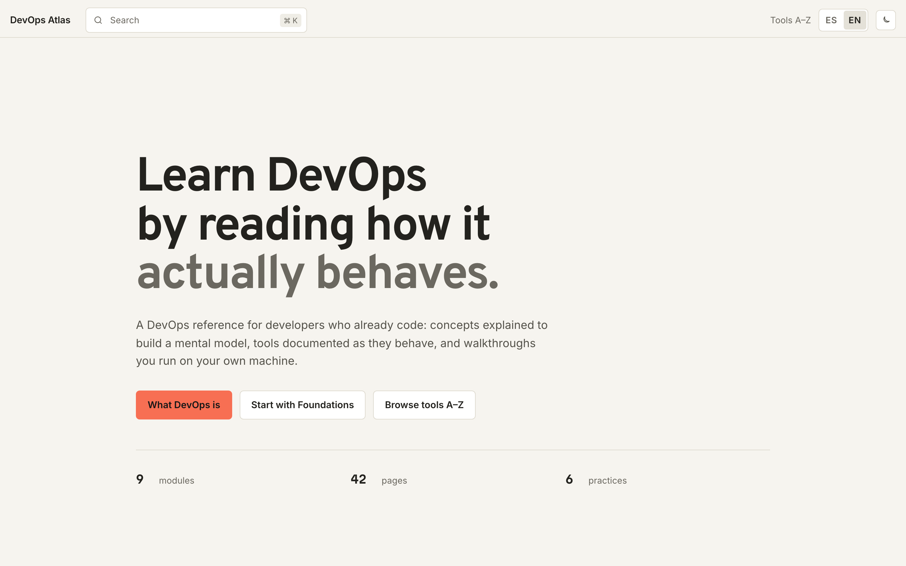

# DevOps Atlas

[](https://github.com/mkrebs03/devops-atlas/actions/workflows/validate.yml)
[](LICENSE)

[Español](README.md) · **English**

A DevOps reference for developers who already code. It covers the jump from writing software to operating it: where each boundary a request crosses sits, what evidence tells two similar failures apart, and why each tool exists. Concepts that build a mental model, tools documented by how they behave, and walkthroughs you run on your own machine.

[](https://devops.mkrebs.tech/en/)

**[devops.mkrebs.tech/en](https://devops.mkrebs.tech/en/)**

## Who it is for

Developers moving toward DevOps: self-taught learners, career switchers, students. It assumes you can write code, use an editor, and read an error. **It does not teach programming from zero.**

## What is inside

Nine modules grouped by the state of the system they describe — one machine, one package, one automated check — plus an A–Z tool index and a glossary. The order suggests a reading path; you can also come in through search or the index.

| #  | Module                   | Tools                                                           | Practice                      |
|----|--------------------------|-----------------------------------------------------------------|-------------------------------|
| 01 | Foundations              | Linux, Bash, curl, ss                                            | Investigate a local app       |
| 02 | Collaboration            | Git, GitHub                                                      | Safe branches                 |
| 03 | One server               | SSH, ufw, systemd, nginx, Certbot                                | From empty VPS to HTTPS       |
| 04 | Containers               | Docker, Docker Compose, nginx                                    | Local pipeline                |
| 05 | Testing                  | Node.js                                                          | Your first test               |
| 06 | Continuous integration   | GitHub Actions, YAML, Git, GitHub                                | —                             |
| 07 | Continuous deployment    | nginx, Traefik, Docker                                           | Promote and roll back         |
| 08 | Scaling                  | Prometheus, OpenTelemetry, PostgreSQL, Kubernetes, Docker Swarm  | —                             |
| 09 | Infrastructure as code   | Terraform, Ansible, SSH                                          | —                             |

42 module pages in total, 6 of them runnable walkthroughs.

## How it is built

A static site built with [Astro](https://astro.build) and [Starlight](https://starlight.astro.build), with no backend: the only thing it writes to the browser is the theme preference (`starlight-theme`). Diagrams are authored as Mermaid blocks and rendered client-side. CI fails the build if a page loses its counterpart in the other language.

## Running it locally

You need Node.js ≥ 20.11 (see [`.node-version`](.node-version)) and pnpm via Corepack:

```bash
corepack enable
corepack prepare pnpm@10.29.3 --activate
```

```bash
git clone https://github.com/mkrebs03/devops-atlas.git
cd devops-atlas
pnpm install --frozen-lockfile
pnpm dev          # http://localhost:4321
```

| Command | What it does |
|---|---|
| `pnpm dev` | Dev server on `localhost:4321` |
| `pnpm run build` | Validates content and builds the site into `dist/` |
| `pnpm preview` | Serves the production build |
| `pnpm run test:e2e` | Playwright smoke tests (Chromium) |

## Docker

```bash
docker build -t devops-atlas .
docker run -p 8080:80 devops-atlas
```

Multi-stage build: compiles with Node, serves the result with nginx. The production procedure — Compose, workflow secrets, and rollback — lives in [`deploy/README.md`](deploy/README.md).

## Status

Nine modules published, from booting a machine to describing that machine in a file, with backups, observability, and secrets along the way. Public clouds, Kubernetes in depth, and security are not covered yet.

## Contributing

Issues are open for bugs, questions, and suggestions, and PRs from any fork are welcome. Merging to `main` is at the maintainer's discretion after review: opening a PR is no guarantee it lands. Content conventions and the steps are in [`CONTRIBUTING.md`](CONTRIBUTING.md).

## License

[MIT](LICENSE) — Martin Sanhueza ([@mkrebs03](https://github.com/mkrebs03)).
