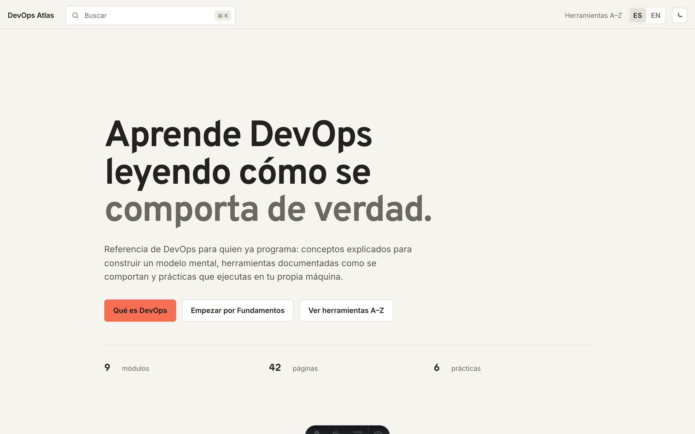

# DevOps Atlas

[](https://github.com/mkrebs03/devops-atlas/actions/workflows/validate.yml)
[](LICENSE)

**Español** · [English](README.en.md)

Mis apuntes de DevOps, organizados como referencia en español y en inglés. Los voy armando a medida que aprendo: una parte de lo que hay la opero a diario y otra solo la he estudiado. La página [Sobre este sitio](https://devops.mkrebs.tech/about/) dice cuál es cuál.

[](https://devops.mkrebs.tech)

**[devops.mkrebs.tech](https://devops.mkrebs.tech)**

## Quién lo escribe

Martín Sanhueza Krebs, estudiante de Ingeniería Informática en la Universidad de La Frontera. Las páginas asumen que quien lee ya programa.

## Qué hay dentro

Ocho módulos agrupados por el estado del sistema que describen —una máquina, un paquete, una comprobación automática—, más un índice A–Z de herramientas y un glosario. El orden sugiere una lectura; también puedes entrar por el buscador o por el índice.

| #  | Módulo                      | Herramientas                                                    | Práctica                        |
|----|-----------------------------|-----------------------------------------------------------------|---------------------------------|
| 01 | Fundamentos                 | Linux, Bash, curl, ss                                           | Investigar una aplicación local |
| 02 | Colaboración                | Git, GitHub                                                     | Ramas seguras                   |
| 03 | Un servidor                 | SSH, ufw, systemd, nginx, Certbot                               | De VPS vacía a HTTPS            |
| 04 | Contenedores                | Docker, Docker Compose, nginx                                   | Empaquetar miapp                |
| 05 | Integración continua        | GitHub Actions, YAML, Node.js, Git, GitHub                      | Una prueba y un workflow        |
| 06 | Despliegue continuo         | GitHub Actions, Docker, Docker Compose, nginx, Traefik          | Promover y revertir             |
| 07 | Operar y escalar            | Prometheus, OpenTelemetry, PostgreSQL, Kubernetes, Docker Swarm | —                               |
| 08 | Infraestructura como código | Terraform, Ansible, SSH                                         | —                               |

Las prácticas trabajan sobre la misma aplicación de ejemplo, de modo que cada una empieza donde terminó la anterior. Son recorridos escritos: no los ejecuté de punta a punta y la salida que muestran es ilustrativa.

## Cómo está hecho

Sitio estático con [Astro](https://astro.build) y [Starlight](https://starlight.astro.build), sin backend: lo único que escribe en el navegador es la preferencia de tema (`starlight-theme`). Los diagramas se escriben como bloques Mermaid y se renderizan en el cliente. El CI rechaza el build si una página pierde su contraparte en el otro idioma.

## Ejecutar en local

Necesitas Node.js ≥ 20.11 (ver [`.node-version`](.node-version)) y pnpm vía Corepack:

```bash
corepack enable
corepack prepare pnpm@10.29.3 --activate
```

```bash
git clone https://github.com/mkrebs03/devops-atlas.git
cd devops-atlas
pnpm install --frozen-lockfile
pnpm dev          # http://localhost:4321
```

| Comando | Qué hace |
|---|---|
| `pnpm dev` | Servidor de desarrollo en `localhost:4321` |
| `pnpm run build` | Valida contenido y genera el sitio en `dist/` |
| `pnpm preview` | Sirve el build de producción |
| `pnpm run test:e2e` | Smoke tests con Playwright (Chromium) |

## Docker

```bash
docker build -t devops-atlas .
docker run -p 8080:80 devops-atlas
```

Build multi-stage: compila con Node y sirve el resultado con nginx. El procedimiento de producción —Compose, secrets del workflow y rollback— vive en [`deploy/README.md`](deploy/README.md).

## Estado

Hay ocho módulos, del arranque de una máquina hasta describir esa máquina en un archivo, con respaldos, observabilidad y secrets por el camino. Todavía no he escrito sobre nubes públicas, seguridad ni Kubernetes más allá de una introducción.

## Contribuir

Los issues están abiertos para correcciones, dudas y sugerencias, y se aceptan PRs desde cualquier fork. El merge a `main` queda a criterio del mantenedor tras revisión: abrir un PR no garantiza que se fusione. Las convenciones de contenido y los pasos están en [`CONTRIBUTING.md`](CONTRIBUTING.md).

## Licencia

[MIT](LICENSE) — Martín Sanhueza Krebs ([@mkrebs03](https://github.com/mkrebs03)).
