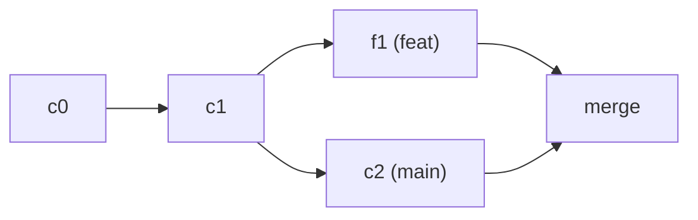

## Por qué Git

Un control de versiones responde tres preguntas que ningún respaldo con fechas en el nombre responde: qué cambió, quién lo cambió y por qué. Git se impuso sobre los anteriores por dos decisiones concretas:

- **Es distribuido.** Al clonar un repositorio te llevas la historia completa, no un enlace a un servidor. Puedes ver el historial, crear ramas y hacer commits sin conexión, y no hay una única copia cuya pérdida sea catastrófica.
- **Ramificar es barato.** Crear una rama es escribir un archivo con el identificador de un commit; no copia nada. Eso es lo que hace posible el flujo de trabajo del resto del módulo: una rama por cambio, revisada aparte y desechada al integrarse.

Y hoy es el estándar de hecho: GitHub, GitLab y las demás plataformas son servicios construidos **sobre** Git. Git es la herramienta que corre en tu máquina; GitHub es un sitio donde alojar una copia y colaborar alrededor de ella.

Un **repositorio** es una carpeta con un subdirectorio `.git` dentro, que contiene toda la historia del proyecto. Se crea de dos formas:

```bash
git init                                    # empezar uno nuevo aquí
git clone https://github.com/usuario/repo   # traer una copia completa de otro
```

## Tres objetos que explican casi todo

Git guarda instantáneas conectadas:

- Un **commit** describe un estado completo y apunta a su padre.
- Una **rama** es una referencia móvil que nombra una línea de commits.
- `HEAD` indica dónde estás trabajando ahora.



Puedes observar el mapa sin modificarlo:

```bash
git status
git log --oneline --graph --decorate --all
git show --stat HEAD
```

## El diff es la unidad de conversación

Un commit no recoge todo lo que tocaste: recoge lo que decidiste incluir. Entre tus archivos y el commit hay un paso intermedio, el **área de preparación**, donde `git add` va colocando los cambios que sí quieres guardar. Por eso existen dos diffs distintos:

```bash
git diff           # lo que cambiaste y aún no preparaste
git diff --cached  # exactamente lo que entrará en el próximo commit
```

Esa diferencia evita que una corrección accidental viaje escondida. Un commit útil responde a una pregunta concreta: qué cambió y por qué. Prefiere varios cambios pequeños antes que uno enorme; un mensaje como `fix: handle empty config` comunica intención, `changes` no.

## Integrar: merge o rebase

Hay dos formas de llevar el trabajo de una rama a otra:

- **merge** crea un commit que une dos líneas y conserva la historia tal como ocurrió.
- **rebase** reaplica tus commits sobre otra base y produce una historia lineal, pero reescribe sus identificadores.

```bash
git switch feat/health
git merge main       # trae main a tu rama con un commit de merge
git rebase main      # o reaplica tus commits sobre main (historia lineal)
```

Regla práctica: **rebasea historia privada, fusiona historia compartida.** Reescribir commits que otras personas ya tienen crea confusión.

Cuando dos ramas cambian la misma línea aparece un **conflicto**. Git marca el archivo y se detiene para que tú decidas:

```text
<<<<<<< HEAD
timeout = 30
=======
timeout = 60
>>>>>>> feat/health
```

Editas el archivo, eliges el resultado correcto, quitas las marcas y luego `git add` para continuar. El conflicto no es un error: es Git pidiéndote una decisión que no puede tomar por ti.

## Qué no versionar

No todo pertenece al repositorio. Secretos, dependencias y artefactos de build se excluyen con `.gitignore`:

```text
node_modules/
.env
dist/
```

Así el diff solo muestra lo que alguien escribió.

## Remotos y confianza

Un remoto es una referencia a otra copia del repositorio. `fetch` trae información; `pull` la combina con tu rama local. Separar ambos pasos hace visible cuándo estás leyendo y cuándo estás integrando.

```bash
git fetch origin
git log --oneline HEAD..origin/main   # ¿qué trae origin que aún no tengo?
```

Publicar es el camino inverso: `git push` envía tus commits al remoto.

```bash
git push -u origin feat/health   # la primera vez: publica la rama y la deja asociada
git push                         # las siguientes
```

Si el remoto tiene commits que tú no, Git rechaza el push en lugar de pisarlos. Primero integras lo que falta (`git pull --rebase`), y después publicas.

## Sigue explorando

- [Pro Git (libro gratis)](https://git-scm.com/book/es/v2) — los capítulos 2 y 3 cubren esto en profundidad.
- [Learn Git Branching](https://learngitbranching.js.org/) — visualiza ramas y merges de forma interactiva.
- `git help glossary` — el vocabulario exacto de cada objeto.
