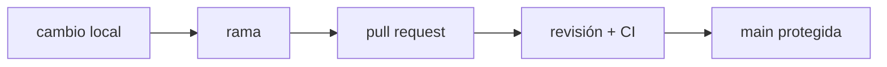

**Dónde estás:** en Fundamentos aprendiste a leer una máquina. Aquí el cambio deja de ser solo tuyo: entra un equipo, y con él la necesidad de que tu trabajo se pueda revisar, explicar y deshacer.

## Entregar también es coordinar

Un cambio de software no termina cuando funciona en tu máquina. Debe tener una historia que otra persona pueda leer, un lugar claro para revisar la intención y una forma de volver atrás.

Git aporta el mapa local; la colaboración añade acuerdos: ramas pequeñas, commits con propósito, revisión y una rama principal protegida.

## De tu máquina al estado compartido

## El recorrido

| Momento | Pregunta | Página |
| --- | --- | --- |
| Modelo | ¿Qué representa un commit? | [El modelo de Git](./git-model/) |
| Cambio | ¿Cómo trabajo sin pisar la rama principal? | [GitHub Flow](./github-flow/) |
| Revisión | ¿Qué debe poder entender otra persona? | [GitHub Flow](./github-flow/) |
| Práctica | ¿Puedo crear y deshacer un cambio seguro? | [Práctica · ramas seguras](./lab-git-branching/) |

:::note[El historial es una interfaz]
Un buen historial no registra cada movimiento del teclado. Registra decisiones pequeñas, coherentes y reversibles.
:::

## Resultado esperado

Al terminar podrás crear una rama con intención, mantenerla actualizada, explicar un diff y abrir un cambio que otra persona pueda revisar sin reconstruir tu contexto desde cero.
