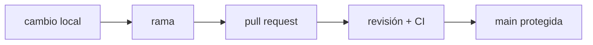

**Dónde estás:** en Fundamentos aprendiste a leer una máquina. Aquí el cambio deja de ser solo tuyo: entra un equipo, y con él la necesidad de que tu trabajo se pueda revisar, explicar y deshacer.

## Entregar también es coordinar

Un cambio de software no termina cuando funciona en tu máquina. Debe tener una historia que otra persona pueda leer, un lugar claro para revisar la intención y una forma de volver atrás.

Git aporta el mapa local; la colaboración añade acuerdos: ramas pequeñas, commits con propósito, revisión y una rama principal protegida.

## De tu máquina al estado compartido

## El recorrido

| Momento | Pregunta | Página |
| --- | --- | --- |
| Modelo | ¿Qué representa un commit? | [El modelo de Git](/collaboration/git-model/) |
| Revisión | ¿Cómo propongo un cambio que otra persona pueda revisar? | [Pull requests y revisión](/collaboration/pull-requests/) |
| Práctica | ¿Puedo crear y deshacer un cambio seguro? | [Práctica · ramas seguras](/collaboration/lab-git-branching/) |

:::note[El historial es una interfaz]
Un buen historial no registra cada movimiento del teclado. Registra decisiones pequeñas, coherentes y reversibles.
:::

## Qué cubre

Estas páginas cubren cómo crear una rama con intención, mantenerla actualizada, leer un diff y abrir un cambio que otra persona pueda revisar sin reconstruir tu contexto desde cero.

## Dónde se rompe esto

| Síntoma | Qué lo causa | Dónde sigue |
| --- | --- | --- |
| El cambio está revisado y aun así falla al instalarlo en otra máquina | El código viaja solo, sin la versión del runtime ni las bibliotecas que necesita | [Contenedores](/containers/) |
| Quien revisa tiene que ejecutar el código para saber si funciona | No hay ninguna comprobación automática que responda esa pregunta antes | [Integración continua](/integration/) |
| Nadie sabe si una rama puede vivir tres días o tres semanas | El equipo no ha decidido su modelo de ramas, así que cada quien usa el suyo | [Estrategias de ramas](/integration/branching-strategy/) |
