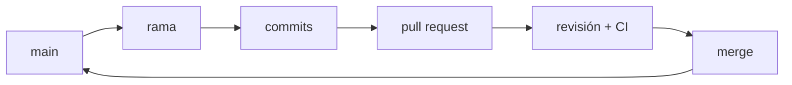

## El recorrido de un cambio



La rama principal representa el estado que el equipo está dispuesto a compartir. Una rama de trabajo crea un espacio temporal para una intención concreta.

```bash
git switch main
git pull --ff-only
git switch -c feat/health-check
```

Cuando el cambio está listo, se publica la rama y se abre la propuesta:

```bash
git push -u origin feat/health-check
gh pr create --fill
```

`gh` es la herramienta de línea de comandos de GitHub. Sin ella, el enlace que imprime `git push` abre el mismo formulario en la web.

Este recorrido —una rama corta que vuelve pronto a `main`— no es la única forma de organizar las ramas de un proyecto, pero sí la más simple, y la que conviene mientras no tengas motivos para otra cosa. Cuáles son esos motivos se decide más adelante, en [Estrategias de ramas](/integration/branching-strategy/), cuando ya sepas qué cuesta un despliegue.

## Pull requests como conversación

Un pull request no es solo un botón de merge. Es una superficie para explicar:

1. Qué problema resuelve el cambio.
2. Qué decisiones tomó quien lo implementó.
3. Cómo se verificó.
4. Qué riesgo queda pendiente.

Un **issue** es la unidad con la que se registra un trabajo pendiente —un fallo reportado, una mejora acordada— con su discusión y su número. Vincula el issue que motiva el cambio (por ejemplo, con `Closes #42`, que además lo cierra al integrar) para que ese contexto viaje con el código. La descripción y el diff deben permitir una revisión específica: "el endpoint devuelve 503 cuando falta la dependencia, y la prueba cubre ese caso" ayuda más que "se ve bien".

## Revisar es leer con intención

Quien revisa no persigue errores de formato —eso lo hace la automatización. Busca tres cosas:

- **Corrección**: ¿el cambio hace lo que dice y cubre los casos límite?
- **Alcance**: ¿el diff contiene una sola intención?
- **Reversibilidad**: ¿se puede deshacer sin arrastrar otras cosas?

Pedir cambios no es un rechazo, es parte de la conversación. Un PR pequeño se revisa de verdad; uno gigante se aprueba de un vistazo, que es peor.

## CI y ramas protegidas

**CI** son las siglas de integración continua: cada cambio propuesto se integra y se valida automáticamente en un servidor limpio, no solo en la máquina de quien lo escribió. Esa automatización elimina las comprobaciones repetitivas —formato, tipos, pruebas y build—. Cuando una comprobación falla, su estado debe ser accionable y apuntar a una evidencia.

Una **rama protegida** convierte esos acuerdos en reglas: exigir al menos una revisión, exigir que CI pase e impedir empujar directo a `main`. Así, la única puerta hacia el estado compartido es un cambio revisado y verificado.

:::caution[No mezcles limpieza con una feature]
Un pull request que cambia comportamiento, renombra archivos y reformatea todo el proyecto cuesta más de revisar. Divide la intención para conservar una señal clara.
:::

## Comprueba lo que entendiste

<details>
<summary>Tu PR toca 40 archivos: la feature y un reformateo masivo. ¿Por qué es un problema?</summary>

Porque mezcla dos intenciones y la revisión pierde señal: los cambios reales quedan escondidos entre miles de líneas de formato. Sepáralos en dos PR (o dos commits claros) para que cada decisión se pueda revisar y revertir por separado.

</details>

<details>
<summary>CI falla en tu PR y la rama está protegida. ¿Puedes hacer merge igual?</summary>

No, y ese es el punto: la protección exige que las comprobaciones pasen antes de integrar a main. Arregla la causa —el estado debería apuntar a la evidencia— y vuelve a ejecutar; recién entonces se habilita el merge.

</details>

## Sigue explorando

- [Pull requests (documentación oficial)](https://docs.github.com/es/pull-requests) — la referencia completa de la superficie de propuesta y revisión.
- [Conventional Commits](https://www.conventionalcommits.org/es/) — mensajes de commit con estructura.
- [Ramas protegidas](https://docs.github.com/es/repositories/configuring-branches-and-merges-in-your-repository/managing-protected-branches) — reglas para proteger main.
