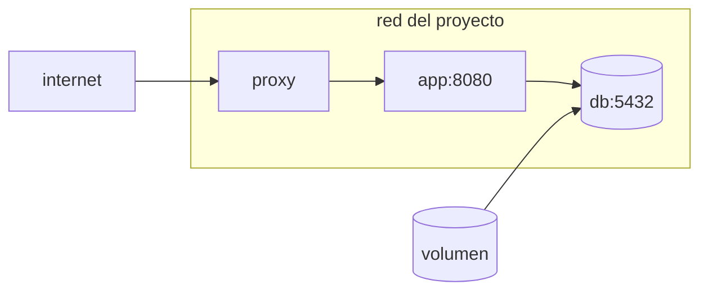

## Un archivo en lugar de una secuencia

Una aplicación real no es un contenedor: son varios que tienen que encontrarse. Con `docker run` eso significa recordar el orden, los nombres, la red y cada bandera de cada arranque —y volver a acertarlos mañana.

**Docker Compose** cambia esa secuencia por una descripción. Escribes cómo debe quedar el conjunto y `docker compose up` lo lleva a ese estado.

```yaml
services:
  app:
    build: .
    environment:
      DATABASE_URL: postgres://atlas:${DB_PASSWORD}@db:5432/atlas
    depends_on:
      db:
        condition: service_healthy
    ports:
      - "127.0.0.1:8080:8080"     # solo alcanzable desde la propia máquina

  db:
    image: postgres:17
    environment:
      POSTGRES_USER: atlas
      POSTGRES_PASSWORD: ${DB_PASSWORD}
    volumes:
      - db-data:/var/lib/postgresql/data
    healthcheck:
      test: ["CMD-SHELL", "pg_isready -U atlas"]
      interval: 5s
      retries: 5

volumes:
  db-data:
```

```bash
docker compose up -d        # levantar en segundo plano
docker compose ps           # qué está corriendo y con qué salud
docker compose logs -f app  # seguir los logs de un servicio
docker compose down         # parar y borrar contenedores y red
```

## Se encuentran por nombre

Compose crea una red para el proyecto y da a cada servicio un nombre resoluble dentro de ella. Por eso la aplicación se conecta a `db:5432` sin saber ninguna IP, y por eso `db` **no** publica ningún puerto: nadie de fuera necesita alcanzarla.



Fíjate en el `ports` de la aplicación: `"127.0.0.1:8080:8080"` y no `"8080:8080"`. La segunda forma publica el puerto en todas las interfaces de la máquina, cortafuegos incluido, y deja tu aplicación accesible sin pasar por el proxy.

:::caution[Publicar un puerto atraviesa ufw]
Docker escribe sus propias reglas por debajo del cortafuegos. Un `ports: "5432:5432"` en tu base de datos la expone a internet aunque `ufw status` no muestre ese puerto abierto. La regla segura es publicar solo lo que el proxy necesita, y siempre con `127.0.0.1:` delante.
:::

## Los datos van en volúmenes

Todo lo que un contenedor escribe en su propio sistema de archivos muere con él. Como borrar y recrear contenedores es la operación normal, cualquier dato que importe tiene que estar en un **volumen**, que Docker gestiona aparte y sobrevive a `docker compose down`.

```bash
docker volume ls                    # qué volúmenes existen
docker compose down                 # borra contenedores; el volumen queda
docker compose down --volumes       # borra también los datos
```

Esa segunda forma es la que borra la base de datos. Vale la pena saberlo antes de escribirla por costumbre.

Hay dos maneras de montar almacenamiento y se confunden:

- **Volumen con nombre** (`db-data:/var/lib/postgresql/data`): Docker decide dónde vive y lo gestiona. Es lo correcto para datos.
- **Bind mount** (`./src:/app/src`): monta una carpeta tuya dentro del contenedor. Útil en desarrollo para ver los cambios sin reconstruir; mala idea en producción, porque el contenido pasa a depender de la máquina anfitriona.

## Arrancar no es estar listo

`depends_on` en su forma simple solo espera a que el contenedor **exista**, no a que el servicio de dentro acepte conexiones. PostgreSQL tarda unos segundos más en estar listo, y en ese hueco tu aplicación intenta conectar y muere.

Hay dos respuestas y conviene tener las dos:

1. Un `healthcheck` en el servicio del que dependes, más `condition: service_healthy` en el que depende —lo que hace el ejemplo de arriba.
2. Que la aplicación reintente la conexión. Es la única que también te protege cuando la base de datos se reinicia con el sistema ya en marcha.

## Un archivo, varios entornos

El mismo conjunto necesita cosas distintas en tu máquina y en el servidor. Compose combina archivos: el segundo sobrescribe lo que declare.

```bash
docker compose -f compose.yml -f compose.prod.yml up -d
```

Los valores que cambian entre entornos —contraseñas, dominios, etiquetas de imagen— salen a un archivo `.env` que no se versiona, y el YAML los referencia con `${DB_PASSWORD}`. El archivo de Compose puede estar en el repositorio; los valores, no.

## Comprueba lo que entendiste

<details>
<summary>¿Por qué la base de datos no lleva ports en el ejemplo?</summary>

Porque solo la aplicación necesita alcanzarla, y lo hace por la red del proyecto usando el nombre `db`. Publicar el puerto la expondría a la máquina anfitriona y, con Docker, también a internet. Si no necesitas conectarte desde fuera, no publiques.

</details>

<details>
<summary>Corriste docker compose down --volumes y perdiste los datos. ¿Qué hacía cada parte?</summary>

`down` para y borra contenedores y la red del proyecto, que son recreables. `--volumes` añade el borrado de los volúmenes, que es lo único que no se puede recrear. El comando hizo exactamente lo que pedía; la bandera es la que hay que escribir a conciencia.

</details>

<details>
<summary>Tu aplicación falla al arrancar con depends_on ya declarado. ¿Por qué?</summary>

Porque `depends_on` sin condición espera a que el contenedor arranque, no a que el servicio esté listo para atender. La base de datos existe pero todavía no acepta conexiones. Necesitas un `healthcheck` con `condition: service_healthy`, y aun así conviene que la aplicación reintente por su cuenta.

</details>

## Sigue explorando

- [Compose · especificación](https://docs.docker.com/reference/compose-file/) — todas las claves del archivo, con sus valores válidos.
- [Compose · volúmenes](https://docs.docker.com/engine/storage/volumes/) — volúmenes con nombre frente a bind mounts.
