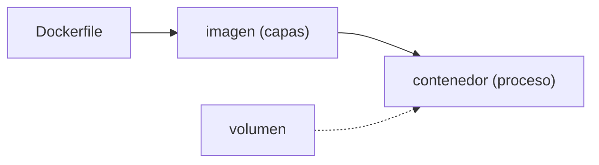

## Por qué contenedores y no máquinas virtuales

El problema que resuelven es viejo: "en mi máquina funciona". La aplicación depende de una versión de Node, de una librería del sistema, de una variable de entorno, de un archivo que alguien dejó en el servidor hace dos años. Nada de eso viaja con el código.

Una **máquina virtual** lo resuelve llevándose la máquina entera: virtualiza el hardware y arranca su propio núcleo con su propio sistema operativo. Funciona, pero cuesta gigabytes y un arranque de minuto.

Un **contenedor** se lleva solo lo que la aplicación necesita —sus archivos, sus dependencias, su configuración— y comparte el núcleo del sistema anfitrión. Lo que aísla no es hardware simulado: son funciones del propio Linux que le dan al proceso su propia vista del sistema de archivos, de la red y de la lista de procesos. Por eso pesa megabytes y arranca en milisegundos.

Ese reparto tiene dos consecuencias prácticas:

- Un contenedor es un proceso de Linux, así que necesita un núcleo Linux debajo. En macOS y Windows, Docker arranca una máquina virtual pequeña donde correrlos.
- El aislamiento es más fino que el de una máquina virtual: comparten núcleo, así que separan menos. Para ejecutar código en el que no confías, la máquina virtual sigue siendo la frontera fuerte.

## Imagen y contenedor no son sinónimos

Una **imagen** es un paquete inmutable de capas. Un **contenedor** es un proceso creado a partir de esa imagen con un entorno de ejecución concreto.



```bash
docker build -t miapp:local .
docker run --rm -p 127.0.0.1:8080:8080 miapp:local
```

La etiqueta ayuda a encontrar una imagen; no convierte `latest` en una versión confiable: `latest` es un nombre que alguien puede reapuntar a otra imagen mañana. Para producción hace falta un identificador que no se mueva, y hay dos que se confunden porque ambos se llaman "SHA":

- El **digest** de la imagen (`miapp@sha256:9f2c…`) es la huella criptográfica de su contenido. Es inmutable de verdad: si cambia un byte, cambia el digest.
- Una **etiqueta con el SHA del commit** (`miapp:sha-abc123`) dice de qué código salió la imagen. Sigue siendo una etiqueta, así que técnicamente se puede reapuntar; lo que la hace fiable es la convención de que el pipeline la escribe una vez y nadie la reutiliza.

Lo habitual es desplegar por la etiqueta del commit, que se lee y se rastrea, y recurrir al digest cuando necesitas la garantía estricta.

Las imágenes no se copian a mano entre máquinas: se publican en un **registro** (Docker Hub, GitHub Container Registry, el registro de tu nube), que funciona como un repositorio remoto de imágenes. `docker push` sube y `docker pull` baja, y esa es la vía por la que un artefacto construido en CI llega al servidor.

## Escribir un Dockerfile

Un `Dockerfile` describe, paso a paso, cómo se construye la imagen. Cada instrucción crea una **capa**:

```dockerfile
# imagen base
FROM node:22-alpine
WORKDIR /app

# primero las dependencias, que cambian poco
COPY package.json package-lock.json ./
RUN npm ci --omit=dev

# después el código, que cambia a diario
COPY . .

# el proceso no corre como root
USER node
EXPOSE 8080
CMD ["node", "server.js"]
```

Los comentarios van en su propia línea: un `#` detrás de una instrucción no es un comentario, es parte de sus argumentos.

El orden importa: copiar primero `package.json` permite que Docker **reutilice** esa capa mientras las dependencias no cambien, aunque edites el código. Copiar todo de golpe invalidaría la caché en cada cambio.

## Capas y caché

Docker construye de arriba hacia abajo y cachea cada capa. Si una instrucción y sus entradas no cambiaron, reutiliza el resultado. Por eso las dependencias van antes que el código: cambias código a diario, dependencias rara vez.

## Multi-stage: construye grande, entrega pequeño

Una etapa compila y otra, mínima, ejecuta. La imagen final no arrastra herramientas de build:

```dockerfile
FROM node:22-alpine AS build
WORKDIR /app
COPY package.json package-lock.json ./
RUN npm ci
COPY . .
RUN npm run build

FROM nginx:alpine
COPY --from=build /app/dist /usr/share/nginx/html
```

La imagen final solo contiene nginx y los archivos estáticos: menos tamaño y menos superficie.

## El contrato de un contenedor

Antes de ejecutar una imagen, define qué proceso arranca, en qué puerto escucha, qué configuración recibe, qué datos deben sobrevivir y cómo se verifica que está sano. Los datos que deben persistir no viven dentro del contenedor: van en un **volumen**.

```bash
docker run --rm -v miapp-data:/var/lib/app miapp:local
```

Si borras el contenedor, el volumen `miapp-data` sigue ahí. Un contenedor es desechable; sus datos no deberían serlo.

## Redes y nombres

En una red Docker, los servicios se encuentran por nombre: un contenedor puede llamar a `http://app:8080` sin saber en qué IP está. Por eso no hace falta publicar cada puerto al host. El patrón habitual es poner delante un [proxy inverso](/server/proxy-tls/): es el único que se expone al exterior y alcanza al resto por su nombre de servicio.

Ese reparto se declara en un archivo de **Docker Compose**, que describe varios contenedores y la red que comparten en lugar de encadenar comandos `docker run`. Cómo se escribe, y qué pasa con los datos cuando esos contenedores se recrean, está en [Varios contenedores con Compose](/containers/compose/).

:::caution[Publica solo lo necesario]
Un servicio que solo necesita ser accesible desde el proxy no debe publicar `80:80` al host. Expón únicamente lo que el contrato del sistema necesita.
:::

## Sigue explorando

- [Referencia de Dockerfile](https://docs.docker.com/reference/dockerfile/) — cada instrucción y su efecto.
- [Docker · caché de build](https://docs.docker.com/build/cache/) — cómo se reutilizan las capas.
- [Play with Docker](https://labs.play-with-docker.com/) — un entorno gratis en el navegador.
