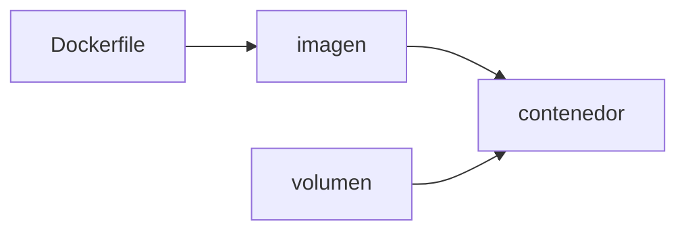

**Dónde estás:** en Colaboración un cambio pasó a ser revisable. Aquí pasa a ser portátil: la aplicación viaja con sus dependencias, así que se ejecuta igual en tu máquina que en un servidor ajeno.

## El problema que resuelve empaquetar

Una aplicación no es solo su código. Es también la versión del runtime, las bibliotecas del sistema, las variables de entorno y el orden en que se instaló todo. Instalar eso a mano en cada máquina produce servidores parecidos pero nunca idénticos, y las diferencias aparecen justo cuando algo falla.

Un contenedor fija esa lista completa en un paquete que se construye una vez y se ejecuta en cualquier parte. Deja de importar qué tenía instalado la máquina antes.

## Tres palabras que vas a leer mucho

- **Imagen**: el paquete inmutable, hecho de capas, que contiene la aplicación y todo lo que necesita para arrancar. Se identifica por etiqueta y, en producción, por su SHA.
- **Contenedor**: el proceso creado a partir de una imagen, con su propio entorno de ejecución. Es desechable: borrarlo y crear otro es la operación normal.
- **Volumen**: almacenamiento que vive fuera del contenedor y sobrevive a su borrado. Ahí van los datos que no puedes perder.

## De la imagen al proceso

El `Dockerfile` describe cómo se construye la imagen. La imagen no cambia. El contenedor sí: nace, escribe en su propia capa temporal y muere. Todo lo que deba sobrevivir a esa muerte tiene que estar en un volumen.

## Mapa del módulo

| Señal | Qué vas a aprender | Página |
| --- | --- | --- |
| Paquete | Qué significa encapsular una aplicación | [Docker sin magia](/containers/docker/) |
| Evidencia | Cómo construir y verificar una imagen local | [Práctica · pipeline local](/containers/lab-container-pipeline/) |

:::note[Un contenedor no es una máquina virtual]
No lleva su propio sistema operativo: comparte el núcleo de la máquina anfitriona y solo aísla el proceso, sus archivos y su red. Por eso arranca en milisegundos y pesa megabytes en vez de gigabytes.
:::

## Qué puedes hacer con esto

Con estas páginas puedes escribir un `Dockerfile`, construir una imagen, ejecutarla y saber dónde quedaron los datos cuando el contenedor desaparece.

## Dónde se rompe esto

| Síntoma | Qué lo causa | Dónde sigue |
| --- | --- | --- |
| La imagen se construye a mano y cada persona la construye distinto | Nadie más que tu máquina sabe producir el paquete | [Integración continua](/integration/) |
| La imagen se construyó con código que nadie comprobó | No hay ninguna verificación entre el commit y el paquete | [Pruebas en CI](/integration/tests-in-ci/) |
| El artefacto existe, pero llegar al servidor sigue siendo manual | Está el paquete y falta el camino hasta producción | [Del build al release](/deployment/pipeline/) |
