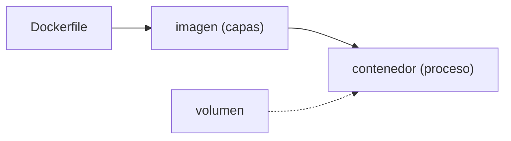

## Imagen y contenedor no son sinónimos

Una **imagen** es un paquete inmutable de capas. Un **contenedor** es un proceso creado a partir de esa imagen con un entorno de ejecución concreto.



```bash
docker build -t atlas-web:local .
docker run --rm -p 8080:80 atlas-web:local
```

La etiqueta ayuda a encontrar una imagen; no convierte `latest` en una versión confiable. Para producción, usa un identificador inmutable como un SHA.

## Escribir un Dockerfile

Un `Dockerfile` describe, paso a paso, cómo se construye la imagen. Cada instrucción crea una **capa**:

```dockerfile
FROM node:22-alpine                    # imagen base
WORKDIR /app                           # directorio de trabajo
COPY package.json pnpm-lock.yaml ./    # primero las dependencias
RUN corepack enable && pnpm install --frozen-lockfile
COPY . .                               # luego el código
RUN pnpm run build                     # produce /app/dist
EXPOSE 8080
CMD ["node", "server.js"]              # proceso que arranca el contenedor
```

El orden importa: copiar primero `package.json` permite que Docker **reutilice** esa capa mientras las dependencias no cambien, aunque edites el código. Copiar todo de golpe invalidaría la caché en cada cambio.

## Capas y caché

Docker construye de arriba hacia abajo y cachea cada capa. Si una instrucción y sus entradas no cambiaron, reutiliza el resultado. Por eso las dependencias van antes que el código: cambias código a diario, dependencias rara vez.

## Multi-stage: construye grande, entrega pequeño

Una etapa compila y otra, mínima, ejecuta. La imagen final no arrastra herramientas de build:

```dockerfile
FROM node:22-alpine AS build
WORKDIR /app
COPY . .
RUN corepack enable && pnpm install --frozen-lockfile && pnpm run build

FROM nginx:alpine
COPY --from=build /app/dist /usr/share/nginx/html
```

La imagen final solo contiene nginx y los archivos estáticos: menos tamaño, menos superficie, menos sorpresas.

## El contrato de un contenedor

Antes de ejecutar una imagen, define qué proceso arranca, en qué puerto escucha, qué configuración recibe, qué datos deben sobrevivir y cómo se verifica que está sano. Los datos que deben persistir no viven dentro del contenedor: van en un **volumen**.

```bash
docker run --rm -v atlas-data:/var/lib/app atlas-web:local
```

Si borras el contenedor, el volumen `atlas-data` sigue ahí. Un contenedor es desechable; sus datos no deberían serlo.

## Redes y nombres

En una red Docker, los servicios se encuentran por nombre. No necesitas publicar cada puerto al host. Si Caddy y una aplicación comparten una red externa, Caddy enruta internamente al nombre del servicio.

```yaml
services:
  atlas:
    image: ghcr.io/example/devops-atlas:sha-abc123
    networks: [caddy-net]

networks:
  caddy-net:
    external: true
```

:::caution Menos superficie, menos sorpresas
Un servicio que solo necesita ser accesible desde Caddy no debe publicar `80:80` al host. Expón únicamente lo que el contrato del sistema necesita.
:::

## Comprueba lo que entendiste

<details>
<summary>Cambias una línea de código y la build reconstruye TODAS las dependencias. Qué está mal?</summary>

Probablemente copias todo el proyecto con `COPY . .` antes de instalar, así que cualquier cambio de código invalida la capa de instalación. Copia primero `package.json` y el lockfile, instala, y recién después copia el resto del código.

</details>

<details>
<summary>Borras el contenedor y pierdes la base de datos. Cómo evitarlo?</summary>

Los datos que deben persistir van en un volumen (`-v nombre:/ruta`), no dentro del contenedor. El contenedor es desechable; el volumen sobrevive a su borrado y puede montarse en uno nuevo.

</details>

## Sigue explorando

- [Referencia de Dockerfile](https://docs.docker.com/reference/dockerfile/) — cada instrucción y su efecto.
- [Docker · caché de build](https://docs.docker.com/build/cache/) — cómo se reutilizan las capas.
- [Play with Docker](https://labs.play-with-docker.com/) — un entorno gratis en el navegador.
