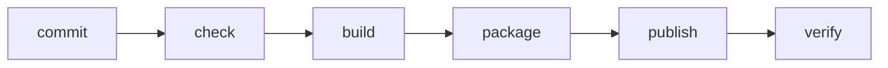

**Dónde estás:** en Colaboración, un cambio pasó a ser revisable. Aquí pasa a ser instalable: se construye, se empaqueta y se comprueba solo, igual cada vez.

## Entregar es reducir incertidumbre

Una pipeline no existe para verse automatizada. Existe para convertir una intención pequeña en evidencia: el código se puede instalar, probar, empaquetar y publicar bajo condiciones conocidas.

## Tres palabras que vas a leer mucho

- **Pipeline**: la secuencia automática de etapas que recorre un cambio desde el commit hasta quedar publicado. Cada etapa deja evidencia y puede detener el avance.
- **Artefacto**: el resultado empaquetado de una construcción —una imagen de contenedor, un `.jar`, una carpeta de archivos estáticos—. Es lo que se despliega, y no es lo mismo que el código del que salió.
- **Entorno**: una instalación completa del sistema, con su propia configuración y sus propios datos. Lo habitual son tres —desarrollo, *staging* y **producción**— y solo en la última hay usuarios reales.

## La cadena de entrega

Docker hace visible el paquete. GitHub Actions hace repetible el recorrido. El feedback de cada etapa debe llegar rápido y explicar qué falló.

## Mapa del módulo

| Señal | Qué vas a aprender | Página |
| --- | --- | --- |
| Paquete | Qué significa encapsular una aplicación | [Docker sin magia](./docker/) |
| Workflow | Cómo expresar una comprobación automática | [GitHub Actions](./github-actions/) |
| Evidencia | Cómo verificar una imagen local | [Práctica · pipeline local](./lab-container-pipeline/) |

:::note[El despliegue empieza antes del servidor]
El servidor no debería ser el primer lugar donde descubres que la aplicación no compila. El servidor recibe artefactos que ya atravesaron controles baratos y repetibles.
:::

## Resultado esperado

Al terminar podrás construir una imagen local, describir las etapas de una pipeline y distinguir entre código fuente, artefacto y entorno de ejecución.
