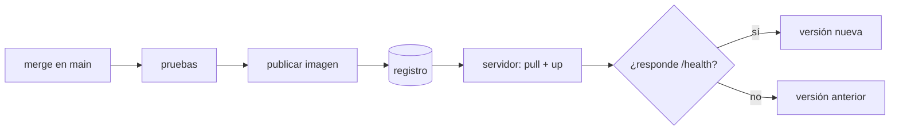

## El tramo que faltaba

Hasta aquí hay dos mitades que no se tocan. De un lado, un workflow que prueba el código y construye la imagen. Del otro, un servidor al que alguien entra por SSH para actualizarlo. Esta página las une: integrar en `main` es lo que despliega.



Cada paso manual de [Desplegar a mano](/server/manual-deploy/) tiene aquí un reemplazo:

| A mano | En el pipeline |
| --- | --- |
| Instalar el runtime en el servidor | Va dentro de la imagen |
| `git pull` e instalar dependencias | El servidor descarga una imagen ya construida |
| Reiniciar el servicio | `docker compose up` con la etiqueta nueva |
| Abrir el sitio para ver si funciona | Una petición a `/health` que decide si el despliegue vale |
| Acordarse de qué había antes | La etiqueta anterior queda guardada antes de cambiar |

## Publicar la imagen

El workflow de CI ya construye la imagen para probarla. Al integrar en `main` hace falta además dejarla en un **registro**, con un nombre que no se pueda confundir con otro: el SHA del commit.

```yaml
  publish:
    needs: [test, image]
    if: github.event_name == 'push' && github.ref == 'refs/heads/main'
    runs-on: ubuntu-latest
    permissions:
      contents: read
      packages: write
    steps:
      - uses: actions/checkout@v4
      - uses: docker/login-action@v3
        with:
          registry: ghcr.io
          username: ${{ github.actor }}
          password: ${{ secrets.GITHUB_TOKEN }}
      - uses: docker/build-push-action@v6
        with:
          context: .
          push: true
          tags: ghcr.io/${{ github.repository }}:sha-${{ github.sha }}
          build-args: APP_VERSION=${{ github.sha }}
```

Tres decisiones en ese bloque:

- **El `if`** limita la publicación a lo ya integrado. Un pull request se prueba, pero no publica nada.
- **`packages: write` solo en este job.** El resto del workflow sigue pudiendo únicamente leer el código.
- **`GITHUB_TOKEN`** es la credencial que GitHub emite para esa ejecución y caduca con ella. No hay ningún token personal guardado.

Para que la aplicación sepa qué versión es, el `Dockerfile` recibe el SHA al construir:

```dockerfile
ARG APP_VERSION=dev
ENV APP_VERSION=$APP_VERSION
```

:::note[El nombre de la imagen va en minúsculas]
Un registro rechaza nombres con mayúsculas. Si tu usuario o tu repositorio las tienen, escribe el nombre a mano en lugar de usar `github.repository`.
:::

## Lo que vive en el servidor

El servidor deja de tener código. Tiene un archivo de Compose que dice qué imagen correr, y esa imagen la decide una variable:

```yaml
# deploy/compose.yml — en el repositorio; el pipeline lo copia a /opt/miapp
services:
  app:
    image: ${MIAPP_IMAGE:?falta MIAPP_IMAGE}
    ports:
      - "127.0.0.1:8080:8080"
    restart: unless-stopped
```

El nginx de [Proxy inverso y certificados](/server/proxy-tls/) no cambia: sigue reenviando a `127.0.0.1:8080`, y le da igual si ahí escucha un proceso de systemd o un contenedor. Lo que sí sobra es la unidad `miapp.service`: `restart: unless-stopped` hace ahora ese trabajo.

El cambio de versión es un script, también en el repositorio:

```bash
#!/usr/bin/env bash
# deploy/deploy.sh — uso: deploy.sh <imagen>
set -euo pipefail
cd /opt/miapp

image="$1"
previous="$(grep -s '^MIAPP_IMAGE=' .env | cut -d= -f2- || true)"

printf 'MIAPP_IMAGE=%s\n' "$image" > .env
docker compose pull
docker compose up --detach

for attempt in 1 2 3 4 5 6 7 8 9 10; do
  if curl --fail --silent http://127.0.0.1:8080/health > /dev/null; then
    echo "desplegado: $image"
    exit 0
  fi
  sleep 2
done

echo "la versión nueva no responde; vuelvo a ${previous:-ninguna}" >&2
if [ -n "$previous" ]; then
  printf 'MIAPP_IMAGE=%s\n' "$previous" > .env
  docker compose up --detach
fi
exit 1
```

El orden es lo que importa. Lee la versión que había **antes** de tocar nada. Cambia. Comprueba durante veinte segundos. Si no responde, vuelve a escribir la etiqueta anterior y termina con error, para que el workflow quede en rojo aunque el servicio haya vuelto a estar en pie.

## El job que despliega

```yaml
  deploy:
    needs: publish
    runs-on: ubuntu-latest
    environment: production
    concurrency: deploy-production
    env:
      IMAGE: ghcr.io/${{ github.repository }}:sha-${{ github.sha }}
      TARGET: ${{ vars.DEPLOY_TARGET }}        # deploy@203.0.113.10
    steps:
      - uses: actions/checkout@v4
      - name: Preparar SSH
        env:
          SSH_KEY: ${{ secrets.DEPLOY_SSH_KEY }}
          KNOWN_HOSTS: ${{ secrets.DEPLOY_KNOWN_HOSTS }}
        run: |
          install -m 700 -d ~/.ssh
          printf '%s\n' "$SSH_KEY" > ~/.ssh/id_ed25519
          printf '%s\n' "$KNOWN_HOSTS" > ~/.ssh/known_hosts
          chmod 600 ~/.ssh/id_ed25519
      - name: Copiar la definición
        run: scp deploy/compose.yml deploy/deploy.sh "$TARGET:/opt/miapp/"
      - name: Cambiar de versión
        run: ssh "$TARGET" "bash /opt/miapp/deploy.sh '$IMAGE'"
      - name: Comprobar desde fuera
        run: curl --fail --silent --show-error --retry 5 --retry-delay 3 https://tu-dominio.com/health
```

- **`environment: production`** permite exigir una aprobación antes de que el job arranque, y es donde se guardan los secretos de ese entorno. Con aprobación es entrega continua; sin ella, despliegue continuo.
- **`concurrency`** impide que dos despliegues corran a la vez y se pisen el archivo `.env`.
- **Copiar la definición en cada despliegue** significa que el servidor no guarda nada que no esté en el repositorio. Si la máquina desaparece, no se pierde ninguna decisión.
- **La comprobación final va por el dominio público**, no por `127.0.0.1`. El script ya verificó el contenedor; esta verifica el camino entero: DNS, certificado, proxy y aplicación.

## La puerta que abre esa clave

El pipeline entra al servidor, así que esa credencial merece el mismo cuidado que cualquier otro acceso:

```bash
# en el servidor, una sola vez
sudo adduser --disabled-password --gecos '' deploy
sudo usermod -aG docker deploy
sudo install -o deploy -g deploy -m 750 -d /opt/miapp
```

```bash
# en tu máquina: un par de claves solo para esto
ssh-keygen -t ed25519 -f deploy_key -N '' -C 'github-actions deploy'
ssh-keyscan -t ed25519 203.0.113.10        # su salida es DEPLOY_KNOWN_HOSTS
```

La clave pública va en `/home/deploy/.ssh/authorized_keys`; la privada, en el secreto `DEPLOY_SSH_KEY`, y se borra de tu disco.

- **Un usuario propio**, sin contraseña y sin `sudo`. No es tu usuario ni tu clave: si se filtra, se revoca sin tocar tu acceso.
- **`known_hosts` fijado.** Sin él, el runner aceptaría cualquier servidor que respondiera en esa IP. Con él, solo habla con la máquina cuya huella guardaste.
- **El grupo `docker` equivale a `root`** sobre esa máquina: quien puede arrancar contenedores puede montar el disco entero. Es aceptable en un servidor dedicado a esto, y es la razón para no reutilizar ese usuario en nada más.

:::caution[El servidor también necesita permiso para descargar]
Una imagen en un registro es privada salvo que digas lo contrario. O la haces pública —razonable si el código ya lo es—, o el servidor inicia sesión con un token que solo pueda leer paquetes. Nunca con el mismo token que publica.
:::

## Qué queda en pie cuando algo falla

| Dónde falla | Qué ve el usuario | Qué queda |
| --- | --- | --- |
| Las pruebas | Nada: sigue la versión anterior | No se publicó ninguna imagen |
| La publicación | Nada | El servidor no se tocó |
| El `pull` en el servidor | Nada | El contenedor anterior sigue corriendo |
| El contenedor nuevo no responde | Unos segundos de corte | El script volvió a la imagen anterior |
| La comprobación por el dominio | Depende de la causa | El contenedor está sano; el fallo está en el proxy, el certificado o el DNS |

La cuarta fila es el límite de este diseño: `docker compose up` para el contenedor viejo antes de arrancar el nuevo, así que siempre hay un instante sin servicio, y unos segundos más si hay que volver. Quitar ese corte exige tener las dos versiones corriendo a la vez y un proxy que cambie entre ellas, que es de lo que tratan [Balanceo de carga](/deployment/load-balancing/) y [Estrategias de despliegue](/deployment/strategies/).

## Comprueba lo que entendiste

<details>
<summary>¿Por qué el servidor descarga una imagen en lugar de hacer git pull y construir?</summary>

Porque lo que se despliega tiene que ser lo que se probó. Si el servidor construye, produce un artefacto nuevo que nadie comprobó, con las dependencias que existan ese día. Descargando por SHA, corre exactamente los mismos bytes que pasaron las pruebas y la prueba de humo.

</details>

<details>
<summary>El contenedor nuevo arranca y el script espera veinte segundos antes de dar el despliegue por bueno. ¿Qué evita eso?</summary>

Confundir "arrancó" con "funciona". `docker compose up` termina bien en cuanto el contenedor existe, aunque el proceso de dentro muera un segundo después. Solo una petición contestada demuestra que la versión atiende, y solo entonces tiene sentido olvidar la anterior.

</details>

<details>
<summary>¿Qué pasaría sin el secreto DEPLOY_KNOWN_HOSTS?</summary>

El runner no tendría con qué comparar la identidad del servidor. O la conexión falla, o —si se desactiva la comprobación para que "funcione"— aceptaría a cualquiera que respondiera en esa dirección y le entregaría la sesión. Fijar la huella es lo que garantiza que la clave privada solo se usa contra tu máquina.

</details>

## Sigue explorando

- [GitHub · publicar imágenes de Docker](https://docs.github.com/es/actions/use-cases-and-examples/publishing-packages/publishing-docker-images) — el flujo completo hacia el registro de GitHub.
- [GitHub · environments](https://docs.github.com/es/actions/deployment/targeting-different-environments/using-environments-for-deployment) — aprobaciones y secretos por entorno.
- [Docker · seguridad del daemon](https://docs.docker.com/engine/security/#docker-daemon-attack-surface) — por qué el grupo `docker` equivale a `root`.
