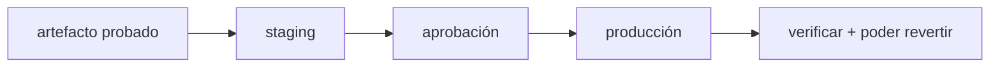

## De integrar a entregar

Ya construyes un artefacto y lo pruebas en CI. Desplegar es el último tramo: llevar ese artefacto a las manos de una persona, bajo condiciones controladas y con una salida de emergencia.

La **integración continua (CI)** mantiene el código siempre integrable. La **entrega continua (CD)** mantiene el artefacto siempre desplegable, y a veces lo despliega sola.

## El recorrido

| Momento | Pregunta | Página |
| --- | --- | --- |
| Pipeline | ¿Cómo pasa un artefacto de build a release? | [Del build al release](./pipeline/) |
| Tráfico | ¿Quién decide a qué instancia llega cada petición? | [Proxy inverso y balanceo](./proxy/) |
| Estrategia | ¿Cómo cambio la versión sin tumbar el servicio? | [Estrategias de despliegue](./strategies/) |
| Evidencia | ¿Cómo sé que la versión nueva se comporta bien? | [Observabilidad](./observability/) |
| Práctica | ¿Puedo promover y revertir una versión? | [Lab · promover y revertir](./lab-release/) |

:::note[Desplegar no es un evento, es una capacidad]
Un equipo maduro no reza antes de un despliegue anual. Despliega seguido, en porciones pequeñas, y puede revertir en minutos.
:::

## Resultado esperado

Al terminar podrás describir un pipeline de entrega, elegir una estrategia de despliegue según el riesgo, saber qué mirar en los minutos siguientes, y practicar una promoción con rollback.
