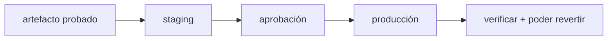

**Dónde estás:** ya tienes un artefacto probado. Queda el último tramo, y el más visible: que llegue solo al servidor, ponerlo delante de usuarios reales sin cortar el servicio y poder volver atrás.

## De integrar a entregar

Ya construyes un artefacto y lo pruebas en CI. Desplegar es el último tramo: llevar ese artefacto a las manos de una persona, bajo condiciones controladas y con una salida de emergencia.

La **integración continua (CI)** mantiene el código siempre integrable. La **entrega continua (CD)** mantiene el artefacto siempre desplegable, y a veces lo despliega sola.

## El recorrido

| Momento | Pregunta | Página |
| --- | --- | --- |
| Pipeline | ¿Cómo pasa un artefacto de build a release? | [Del build al release](/deployment/pipeline/) |
| Automatización | ¿Cómo llega la imagen al servidor sin que nadie entre por SSH? | [Desplegar desde el pipeline](/deployment/deploy-from-pipeline/) |
| Tráfico | ¿Quién decide a qué instancia llega cada petición? | [Balanceo de carga](/deployment/load-balancing/) |
| Estrategia | ¿Cómo cambio la versión sin tumbar el servicio? | [Estrategias de despliegue](/deployment/strategies/) |
| Práctica | ¿Puedo promover y revertir una versión? | [Práctica · promover y revertir](/deployment/lab-release/) |

:::note[Desplegar seguido]
Desplegar seguido y en porciones pequeñas, con una reversión que tarda minutos, baja el riesgo de cada entrega.
:::

## Qué cubre

Estas páginas cubren las etapas de un pipeline de entrega, un despliegue que sale de un merge en `main` y vuelve atrás si falla, las estrategias según el riesgo y una promoción con rollback.

## Dónde se rompe esto

| Síntoma | Qué lo causa | Dónde sigue |
| --- | --- | --- |
| El despliegue termina y nadie sabe si el servicio quedó sano | La evidencia se acaba en el pipeline y no continúa en producción | [Observabilidad](/scaling/observability/) |
| Una sola máquina recibe todo el tráfico, y su caída es la caída del servicio | No hay una segunda instancia a la que el balanceador pueda mandar peticiones | [Cuándo escalar y cómo](/scaling/when-to-scale/) |
| El servidor al que despliegas se configuró a mano y nadie sabría rehacerlo | La aplicación está automatizada y la máquina que la sostiene no | [Infraestructura como código](/infrastructure/) |
