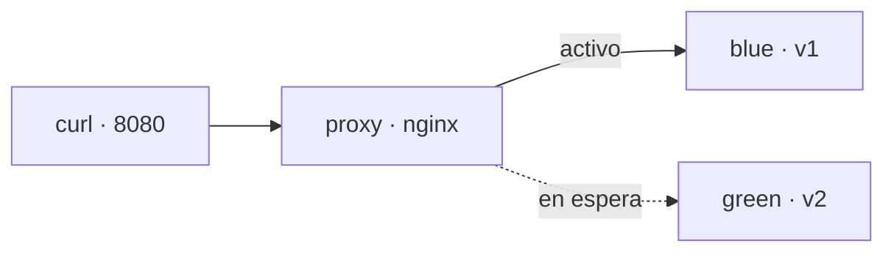

:::note[Práctica escrita, no ejecutada de punta a punta]
No corrí este recorrido completo. La salida que aparece es ilustrativa y puede diferir de la tuya. Si un paso no funciona, [abre un issue](https://github.com/mkrebs03/devops-atlas/issues).
:::

## Estado final

Dos versiones de `miapp` corriendo a la vez, un nginx delante que decide cuál atiende, y un bucle de peticiones que demuestra que cambiar de una a otra —y volver— no corta nada.



## Requisitos

- Docker en ejecución.
- La carpeta `~/miapp` con su `Dockerfile`, de la [práctica de contenedores](/containers/lab-container-pipeline/).
- Dos terminales.
- Si tu Docker corre en una máquina virtual (Colima, Docker Desktop), trabaja dentro de tu carpeta personal, como hace la práctica: son las rutas que la máquina virtual puede montar.
- Unos 20 minutos.

## Paso 1 · La versión azul, detrás del proxy

```bash
docker build --tag miapp:local ~/miapp
mkdir -p ~/atlas-bluegreen/conf && cd ~/atlas-bluegreen

docker network create atlas-bg
docker run --detach --name blue --network atlas-bg --env APP_VERSION=v1 miapp:local

cat > conf/default.conf <<'EOF'
server {
  listen 80;
  location / {
    proxy_pass http://blue:8080;
  }
}
EOF

docker run --detach --name proxy --network atlas-bg \
  --publish 127.0.0.1:8080:80 \
  --volume "$PWD/conf:/etc/nginx/conf.d:ro" nginx:alpine

curl -s http://127.0.0.1:8080/
```

`blue` no publica ningún puerto. El único contenedor alcanzable desde tu máquina es el proxy, que llega a `blue` por su nombre dentro de la red `atlas-bg`.

**Señal:** `miapp v1`.

## Paso 2 · Deja corriendo el tráfico

En la **segunda terminal**, lanza peticiones sin parar y déjalas ahí durante toda la práctica:

```bash
while true; do
  curl -sf -m 2 http://127.0.0.1:8080/ || echo FALLO
  sleep 0.3
done
```

**Señal:** una columna de `miapp v1`. Cualquier petición que no reciba un `200` imprimiría `FALLO`.

## Paso 3 · La versión verde, en aislamiento

```bash
docker run --detach --name green --network atlas-bg --env APP_VERSION=v2 miapp:local
docker run --rm --network atlas-bg alpine wget -qO- http://green:8080/
docker run --rm --network atlas-bg alpine wget -qO- http://green:8080/health
```

**Señal:** `miapp v2` y `{"status":"ok"}` desde dentro de la red, mientras la segunda terminal sigue diciendo `miapp v1`. La versión nueva está desplegada y nadie la está usando: esa es la prueba de humo antes de darle tráfico.

## Paso 4 · Cambia el tráfico

```bash
cat > conf/default.conf <<'EOF'
server {
  listen 80;
  location / {
    proxy_pass http://green:8080;
  }
}
EOF

docker exec proxy nginx -t && docker exec proxy nginx -s reload
```

`nginx -t` valida el archivo; `-s reload` arranca procesos nuevos con la configuración nueva y deja que los viejos terminen las peticiones que tenían entre manos antes de salir.

**Señal:** en la segunda terminal, la columna pasa de `miapp v1` a `miapp v2` sin ningún `FALLO` en medio.

## Paso 5 · Un cambio roto no llega al tráfico

Apunta el proxy a un destino que no existe:

```bash
cat > conf/default.conf <<'EOF'
server {
  listen 80;
  location / {
    proxy_pass http://purple:8080;
  }
}
EOF

docker exec proxy nginx -t && docker exec proxy nginx -s reload
```

**Señal:** `nginx -t` falla con `host not found in upstream "purple"`, el `&&` impide la recarga, y la segunda terminal sigue en `miapp v2`. El archivo en disco está roto y el proxy sigue sirviendo con la última configuración válida.

## Paso 6 · Revierte

Algo salió mal con la verde. Volver es la misma operación, hacia el otro lado:

```bash
cat > conf/default.conf <<'EOF'
server {
  listen 80;
  location / {
    proxy_pass http://blue:8080;
  }
}
EOF

docker exec proxy nginx -t && docker exec proxy nginx -s reload
```

**Señal:** la columna vuelve a `miapp v1`, otra vez sin `FALLO`. No reconstruiste ni arrancaste nada: `blue` seguía ahí, y por eso el rollback tarda lo que tarda una recarga.

Ese es también el coste del blue-green: mientras quieras poder volver, pagas las dos versiones corriendo.

## Si algo no cuadra

| Síntoma | Causa probable | Comando |
| --- | --- | --- |
| `FALLO` continuo desde el principio | El proxy no arrancó | `docker logs proxy` |
| `502 Bad Gateway` al pedir sin `-f` | El contenedor de destino no corre | `docker ps` |
| `host not found in upstream` al arrancar el proxy | `blue` no existe o está en otra red | `docker network inspect atlas-bg` |
| La recarga no cambia nada | El archivo editado no es el montado | `docker exec proxy cat /etc/nginx/conf.d/default.conf` |
| `name is already in use` | Quedaron contenedores de un intento anterior | La sección de limpieza |

## Limpieza

Detén el bucle de la segunda terminal con `Ctrl+C`. Después:

```bash
docker rm --force proxy blue green
docker network rm atlas-bg
rm -rf ~/atlas-bluegreen
```
