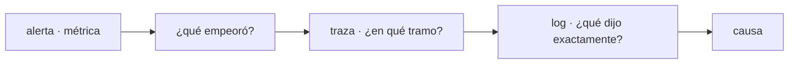

## Desplegaste. ¿Y ahora?

Las pruebas demostraron que el código hace lo que dice, en condiciones que tú elegiste. Producción es lo otro: usuarios reales, datos reales, una red que falla, una dependencia que tarda. Nada de eso cabe en una suite de pruebas.

La pregunta después de un despliegue no es "¿funciona?". Es **qué está haciendo el sistema ahora mismo, y en qué se diferencia de hace diez minutos**. Un sistema observable puede responder eso sin que despliegues nada nuevo para averiguarlo.

Esa es la diferencia entre monitorizar y observar. Monitorizar es vigilar las preguntas que ya sabías hacer —un panel con CPU y memoria—. La **observabilidad** es la propiedad de poder responder preguntas que no anticipaste: por qué justo estos usuarios ven errores, por qué solo desde la app móvil, por qué solo desde que salió la versión de ayer.

## Tres señales

Casi todo lo que vas a instalar y configurar cae en una de tres categorías, y cada una responde una pregunta distinta.

| Señal | Qué responde | Coste |
| --- | --- | --- |
| **Métricas** | ¿Cuánto, con qué frecuencia, desde cuándo? | Barato: son números agregados |
| **Trazas** | ¿Dónde se fue el tiempo dentro de esta petición? | Medio: se suele muestrear |
| **Logs** | ¿Qué pasó exactamente en este caso concreto? | Caro: crece con el tráfico |

**Las métricas** son números medidos en el tiempo: peticiones por segundo, errores por minuto, milisegundos de respuesta, memoria en uso. Son baratas de guardar y perfectas para ver tendencias y disparar alertas. Lo que no te dicen es *por qué*.

```text
http_requests_total{route="/api/orders",status="500"}  1428
http_request_duration_seconds{route="/api/orders",quantile="0.99"}  2.4
```

**Las trazas** siguen una misma petición a través de todos los servicios que atraviesa y miden cuánto tardó en cada tramo. En un sistema con varias piezas, es la única señal que responde "¿el lento es el servicio o la base de datos?".

**Los logs** son el registro evento a evento. Sirven para el caso concreto: este usuario, a esta hora, con este error. Dos hábitos los vuelven útiles de verdad:

- **Escribirlos estructurados**, como JSON con campos, y no como frases sueltas. Una frase se lee; un campo se filtra y se agrega.
- **Llevar un identificador de correlación**: el mismo id en todos los logs de una petición, para poder reconstruir su recorrido completo.

```json
{"ts":"2026-07-26T10:14:02Z","level":"error","request_id":"a1b2c3","route":"/api/orders","status":500,"msg":"payment gateway timeout"}
```

## Qué medir

Un sistema tiene infinitos números y casi ninguno importa. Cuatro señales describen la salud de casi cualquier servicio:

- **Latencia** — cuánto tarda en responder. Separa las respuestas correctas de las fallidas: un error devuelto rápido no es una buena noticia.
- **Tráfico** — cuánta demanda está recibiendo.
- **Errores** — qué fracción de las peticiones falla, incluidas las que devuelven `200` con el cuerpo equivocado.
- **Saturación** — cuán lleno está el recurso más limitado (CPU, memoria, conexiones a la base de datos, cola de trabajos).

Y mídelas **en la frontera donde el usuario las nota**: en el proxy o en el borde de tu API, no solo dentro del proceso. Un servicio puede estar perfectamente sano mientras la cola de espera crece delante de él.

:::caution[El promedio miente]
Si la mitad de tus usuarios recibe respuesta en 50 ms y la otra mitad en 4 s, el promedio dice 2 s y no describe la experiencia de nadie. Usa percentiles: el **p95** es lo que sufre 1 de cada 20 peticiones, y el **p99** es lo que sufren justo tus usuarios más activos, porque hacen más peticiones.
:::

## Después de desplegar

Aquí es donde esto se conecta con el resto del módulo. Un despliegue no termina cuando la versión nueva arranca, sino cuando has comprobado que se comporta como la anterior. En los primeros minutos, compara **la versión nueva contra la que ya estaba**:

- Tasa de errores: ¿subió respecto a la versión anterior?
- Latencia p95 y p99: ¿se degradó?
- Saturación: ¿la versión nueva consume mucho más para lo mismo?

Eso es exactamente lo que significaba "si las métricas están sanas" en un [canary](/deployment/strategies/): no una corazonada, sino esos tres números comparados entre las dos versiones que están sirviendo tráfico a la vez. Si empeoran, retiras el canary antes de que le llegue al resto de la gente.

Un **chequeo de salud** —el que ya viste en [el proxy](/deployment/load-balancing/)— responde solo a "¿puede atender?". La observabilidad responde a "¿está atendiendo bien?". No se sustituyen.

## Alertas: avisa de síntomas, no de causas

Una alerta debería significar: *alguien está sufriendo algo, y hay algo que hacer al respecto*. Ese listón descarta la mayoría de las alertas que la gente configura al empezar.

- **Sobre síntomas**: "el 5% de las peticiones a `/checkout` falla" o "el p99 pasó de 300 ms a 3 s". Le pasa a alguien.
- **No sobre causas**: "la CPU está al 80%". Puede ser perfectamente normal, y si no lo es, ya lo dirá la latencia.

Y cada alerta necesita a alguien que pueda actuar y algo que hacer. Una alerta que no se puede accionar se ignora, y una vez que el equipo aprende a ignorar una, empieza a ignorar el resto —el mismo mecanismo por el que una [prueba frágil](/testing/pyramid/) acaba destruyendo la confianza en toda la suite.

## Las tres señales trabajan juntas

Cada una entra en un momento distinto de la investigación, y el recorrido es siempre el mismo:



Es el mismo bucle de diagnóstico de [la terminal](/foundations/terminal/), a escala de sistema: ubicar, medir, filtrar, actuar, verificar. Cambia la herramienta, no el método.

## Comprueba lo que entendiste

<details>
<summary>Tu panel dice que la latencia media está en 200 ms y los usuarios se quejan de lentitud. ¿Qué miras?</summary>

Los percentiles. Una media de 200 ms es compatible con que el 5% de las peticiones tarde varios segundos, y esa cola es justo lo que la gente nota y recuerda. Mira el p95 y el p99, y sepáralos por ruta: lo más probable es que un endpoint concreto esté arrastrando la experiencia.

</details>

<details>
<summary>Recibes una alerta de "memoria al 85%" tres veces por semana y nunca ha pasado nada. ¿Qué está mal?</summary>

Es una alerta sobre una causa, no sobre un síntoma, y no es accionable: nadie sabe qué hacer con ella, así que se aprende a ignorarla. Sustitúyela por lo que de verdad afectaría a alguien —errores, latencia, peticiones rechazadas— y deja la memoria como un número que consultas *cuando* investigas, no como algo que te despierta.

</details>

## Sigue explorando

- [Google SRE · Monitoring distributed systems](https://sre.google/sre-book/monitoring-distributed-systems/) — el capítulo donde se definen las cuatro señales doradas.
- [OpenTelemetry](https://opentelemetry.io/docs/what-is-opentelemetry/) — el estándar con el que hoy se instrumentan métricas, trazas y logs.
- [Prometheus · primeros pasos](https://prometheus.io/docs/introduction/overview/) — el recolector de métricas más común, y su modelo de datos.
