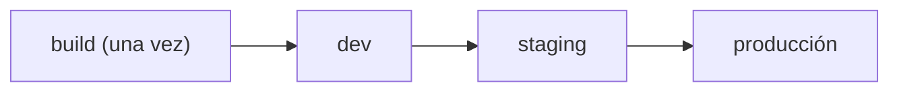

## Tres CD que no son lo mismo

- **Integración continua**: cada cambio se integra y valida seguido.
- **Entrega continua**: el artefacto queda siempre listo para desplegar; el paso a producción es un botón.
- **Despliegue continuo**: ese botón es automático cuando las comprobaciones pasan.

La diferencia entre los dos últimos es una **compuerta**: manual o automática.

## Construye una vez, promueve el mismo artefacto

El error clásico es reconstruir en cada entorno. Si `staging` y `producción` compilan por separado, no estás probando lo que despliegas. Construye **una** imagen, identifícala por su SHA y promueve esa misma imagen:



```bash
# la misma imagen inmutable atraviesa los entornos
docker tag app:sha-abc123 registry/app:sha-abc123
docker push registry/app:sha-abc123
```

## Los entornos ganan confianza

Cada entorno responde una pregunta: ¿arranca?, ¿pasa las pruebas de humo?, ¿se comporta con datos realistas? Producción no debería ser el primer lugar donde una versión se ejecuta.

Una **compuerta de aprobación** —por ejemplo, un `environment` protegido en GitHub Actions— hace explícito quién autoriza el paso final.

:::tip Config por entorno, artefacto único
Lo que cambia entre entornos es la configuración (variables, secretos, URLs), no el binario. Mismo artefacto, distinta config: así lo que probaste es lo que corre.
:::

## Comprueba lo que entendiste

<details>
<summary>Tu pipeline compila la imagen en staging y otra vez en producción. Qué riesgo introduces?</summary>

Que no estás desplegando lo que probaste: dos builds pueden diferir por dependencias, caché o momento. Construye una sola imagen, identifícala por su SHA y promueve esa misma a cada entorno; la config cambia, el artefacto no.

</details>

<details>
<summary>Cuál es la diferencia entre entrega continua y despliegue continuo?</summary>

La compuerta. En entrega continua el artefacto queda listo y una persona aprueba el paso a producción; en despliegue continuo ese paso es automático cuando todas las comprobaciones pasan.

</details>

## Sigue explorando

- [Continuous Delivery (Martin Fowler)](https://martinfowler.com/bliki/ContinuousDelivery.html) — la definición de referencia.
- [The Twelve-Factor App · config](https://12factor.net/es/config) — por qué la config va por entorno.
