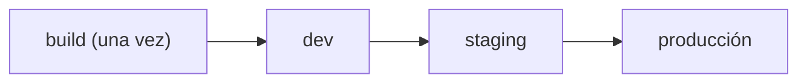

## CI, CD y CD: tres siglas que no son lo mismo

- **Integración continua**: cada cambio se integra y valida seguido.
- **Entrega continua**: el artefacto queda siempre listo para desplegar; el paso a producción es un botón.
- **Despliegue continuo**: ese botón es automático cuando las comprobaciones pasan.

La diferencia entre los dos últimos es una **compuerta**: manual o automática.

## Construye una vez, promueve el mismo artefacto

El error clásico es reconstruir en cada entorno. Si `staging` y `producción` compilan por separado, no estás probando lo que despliegas. Construye **una** imagen, etiquétala con el SHA del commit del que salió y promueve esa misma imagen:



```bash
# la misma imagen inmutable atraviesa los entornos
docker tag miapp:sha-abc123 registry/miapp:sha-abc123
docker push registry/miapp:sha-abc123
```

Cómo se hace eso desde un workflow, y cómo llega esa imagen al servidor, está en [Desplegar desde el pipeline](/deployment/deploy-from-pipeline/).

## Los entornos ganan confianza

Cada entorno responde una pregunta: ¿arranca?, ¿pasa las pruebas de humo?, ¿se comporta con datos realistas? Producción no debería ser el primer lugar donde una versión se ejecuta.

Una **prueba de humo** es la comprobación mínima de que la versión está viva: responde el endpoint de salud, carga la página principal, conecta con la base de datos. No sustituye a la suite de pruebas; solo descarta que hayas desplegado algo que ni siquiera arranca.

Una **compuerta de aprobación** —por ejemplo, un `environment` protegido en GitHub Actions— hace explícito quién autoriza el paso final.

:::tip[Config por entorno, artefacto único]
Lo que cambia entre entornos es la configuración (variables, secretos, URLs), no el binario. Mismo artefacto, distinta config: así lo que probaste es lo que corre.
:::

## Sigue explorando

- [Continuous Delivery (Martin Fowler)](https://martinfowler.com/bliki/ContinuousDelivery.html) — la definición de referencia.
- [The Twelve-Factor App · config](https://12factor.net/es/config) — por qué la config va por entorno.
