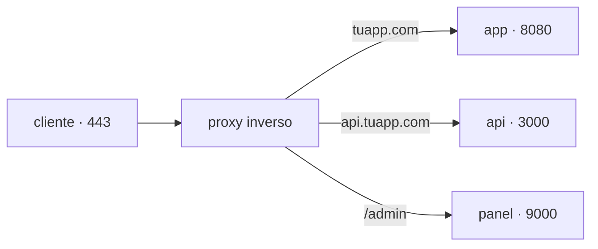

## Un solo 443 para muchos servicios

Tu servidor tiene una IP y una aplicación escuchando en el puerto 8080. El navegador de un usuario no conoce ese puerto: pide `https://tuapp.com`, que significa el puerto 443. Y mañana quieres alojar ahí una segunda aplicación, y una API, y el panel de administración.

No pueden escuchar todas en 443: un puerto lo ocupa un proceso. Hace falta algo delante que reciba todo el tráfico y decida a dónde va cada petición.



Eso es un **proxy inverso**: un servidor que recibe las peticiones en nombre de tus servicios y las reenvía al que corresponde. Se llama "inverso" porque un proxy normal representa al cliente ante internet; este representa al servidor ante el cliente, que nunca sabe qué hay detrás.

## Qué te compra

Enrutar es solo la primera razón. Un proxy inverso concentra en un punto cuatro cosas que si no tendrías que resolver en cada aplicación:

- **TLS.** El certificado se instala y se renueva en un solo lugar. El proxy descifra la conexión y habla con tus servicios por la red interna. Se le llama *terminación TLS*.
- **Superficie mínima.** Tus servicios dejan de publicar puertos al exterior: solo el proxy es alcanzable desde internet, y el resto vive en una red interna donde se encuentran por nombre.
- **Reglas comunes.** Límites de tamaño y de frecuencia, cabeceras de seguridad, compresión, tiempos de espera: se escriben una vez y valen para todo lo que hay detrás.
- **Un único registro de acceso.** Todas las peticiones pasan por el mismo sitio, así que hay un solo lugar donde ver qué está entrando.

```nginx
server {
  listen 443 ssl;
  server_name tuapp.com;

  location / {
    proxy_pass http://app:8080;      # "app" es el nombre del servicio en la red interna
    proxy_set_header Host $host;
    proxy_set_header X-Forwarded-For $remote_addr;
  }
}
```

Esas dos cabeceras importan más de lo que parece: sin ellas, tu aplicación cree que todas las peticiones vienen del proxy y no del usuario, y los logs dejan de servir para investigar nada.

:::note[Caddy, Traefik, nginx: el mismo papel]
Cambia la sintaxis y cuánto se automatiza —Caddy pide y renueva certificados solo, Traefik se configura leyendo etiquetas de los contenedores—, pero los tres ocupan el mismo sitio en el diagrama. Elige por operación, no por rendimiento: para casi cualquier carga real, los tres sobran.
:::

## Balanceo: varias instancias del mismo servicio

Cuando una sola instancia no da abasto, o cuando no quieres que su caída sea la caída del servicio, corres varias copias iguales. Ahora el proxy tiene una decisión más: a **cuál** de ellas mandar cada petición. Eso es **balanceo de carga**.

```nginx
upstream app {
  server app-1:8080;
  server app-2:8080;
  server app-3:8080;
}
```

El reparto por defecto es por turnos (*round robin*): una a cada una, en orden. También se puede repartir por menos conexiones activas, o fijar un cliente a una instancia concreta.

Pero lo que de verdad convierte al balanceador en algo útil es el **chequeo de salud**: cada pocos segundos pregunta a cada instancia si está bien —normalmente pidiendo un endpoint como `/health`— y **retira de la rotación** a la que no responde. Sin eso, un balanceador sigue enviando tráfico a una instancia muerta y una de cada tres peticiones falla.

```bash
curl -s http://127.0.0.1:8080/health
# {"status":"ok","db":"ok"}
```

Que ese endpoint sea honesto es responsabilidad de la aplicación: si devuelve `200` sin comprobar sus dependencias, el balanceador mantendrá en rotación una instancia que no puede atender a nadie.

## Por qué sin esto no hay estrategias de despliegue

Aquí está la razón de fondo para leer esta página antes que la siguiente. Desplegar sin cortar el servicio siempre consiste en lo mismo: **cambiar a dónde apunta el tráfico**. Lo único que cambia entre estrategias es qué se toca en el proxy.

| Estrategia | Qué cambia en el proxy |
| --- | --- |
| Rolling | Sacas una instancia de rotación, la actualizas, la devuelves; repites |
| Blue-green | Cambias el destino del bloque `upstream` de la versión vieja a la nueva |
| Canary | Repartes con pesos: 95% a la versión actual, 5% a la nueva |

Y el rollback es la misma operación en sentido contrario, que es lo que lo hace rápido: no reconstruyes nada, vuelves a apuntar.

:::caution[Las conexiones abiertas no desaparecen solas]
Al retirar una instancia, las peticiones que ya estaba atendiendo siguen vivas. Un despliegue sin downtime necesita un *drenaje*: dejar de mandarle tráfico nuevo, esperar a que termine lo que tiene entre manos y solo entonces apagarla.
:::

## El estado estorba

Si tu aplicación guarda algo en su propia memoria —la sesión de quien inició sesión, un carrito, un archivo subido—, balancear la rompe: la siguiente petición del mismo usuario aterriza en otra instancia que no sabe nada de eso.

La salida no es atar cada usuario a una instancia, sino sacar el estado fuera: sesiones en una base de datos o en Redis, archivos en almacenamiento compartido. Una aplicación cuyas instancias son intercambiables es la que se puede escalar y desplegar sin ceremonia.

## Comprueba lo que entendiste

<details>
<summary>Tienes tres instancias y una se queda sin base de datos. ¿Por qué siguen fallando un tercio de las peticiones?</summary>

Porque el balanceador la sigue considerando sana. O no hay chequeo de salud configurado, o el endpoint devuelve `200` sin comprobar sus dependencias. Que el proceso siga vivo no significa que pueda atender: el chequeo tiene que verificar lo que la aplicación necesita para responder.

</details>

<details>
<summary>¿Por qué un blue-green es casi instantáneo, si la versión nueva tarda minutos en arrancar?</summary>

Porque arrancar y cambiar el tráfico son dos momentos distintos. La versión nueva se levanta y se verifica tranquilamente mientras nadie la usa; el despliegue en sí es solo el cambio de destino en el proxy, que es inmediato. Y por eso volver atrás también lo es.

</details>

## Sigue explorando

- [nginx · balanceo de carga](https://nginx.org/en/docs/http/load_balancing.html) — los métodos de reparto y su configuración.
- [Caddy · reverse_proxy](https://caddyserver.com/docs/caddyfile/directives/reverse_proxy) — el mismo papel con certificados automáticos.
- [The Twelve-Factor App · procesos](https://12factor.net/es/processes) — por qué el estado no vive dentro del proceso.
