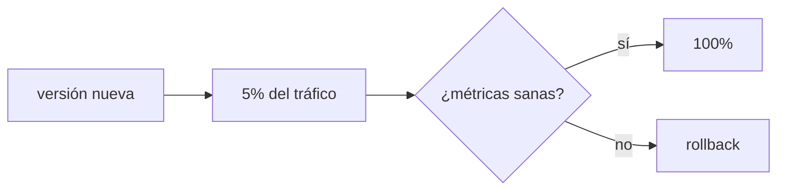

:::note
Blue-green y canary los he estudiado, pero no los he aplicado en un sistema real. En [Sobre este sitio](/about/) está el detalle de qué opero y qué no.
:::

## Cambiar la versión sin tumbar el servicio

Actualizar significa reemplazar la versión que sirve tráfico. Cómo lo haces decide cuánta gente ve un fallo si algo sale mal.

Las cuatro estrategias que siguen son formas distintas de hacer una misma operación: cambiar a dónde apunta el tráfico. Quien la ejecuta es el proxy o el balanceador que tienes delante, así que conviene tener claro [qué hace esa pieza](/deployment/load-balancing/) antes de elegir.

## Cuatro estrategias

- **Recreate**: apaga la vieja, enciende la nueva. Simple, pero hay downtime.
- **Rolling**: reemplaza instancias de a poco. Sin downtime, pero conviven dos versiones un rato.
- **Blue-green**: dos entornos completos (azul actual, verde nuevo); cambias el tráfico de golpe y puedes volver al azul al instante.
- **Canary**: la versión nueva recibe primero una fracción del tráfico; si [las métricas](/scaling/observability/) están sanas, subes; si no, la retiras.

## Elegir según el riesgo

| Estrategia | Downtime | Costo | Rollback |
| --- | --- | --- | --- |
| Recreate | Sí | Bajo | Redesplegar la anterior |
| Rolling | No | Bajo | Rolling inverso |
| Blue-green | No | Alto (2x) | Cambiar el tráfico al azul |
| Canary | No | Medio | Retirar el canary |

No hay una mejor: un blog personal tolera recreate; un servicio de pagos quiere canary con rollback ensayado.

## El rollback es parte del plan

Antes de lanzar, responde: ¿cómo vuelvo a la versión anterior, en cuánto tiempo, y qué pasa con los datos ya migrados? Conviene ensayar el rollback antes de necesitarlo.

:::caution[Las migraciones de datos no siempre revierten]
Cambiar código es reversible; borrar una columna, no. Diseña cambios de esquema compatibles hacia atrás (agrega antes de quitar) para que un rollback de código no deje datos huérfanos.
:::

## Sigue explorando

- [Deployments (Kubernetes)](https://kubernetes.io/docs/concepts/workloads/controllers/deployment/) — rolling updates en la práctica.
- [Canary release (Martin Fowler)](https://martinfowler.com/bliki/CanaryRelease.html)
- [Blue-green deployment (Martin Fowler)](https://martinfowler.com/bliki/BlueGreenDeployment.html)
