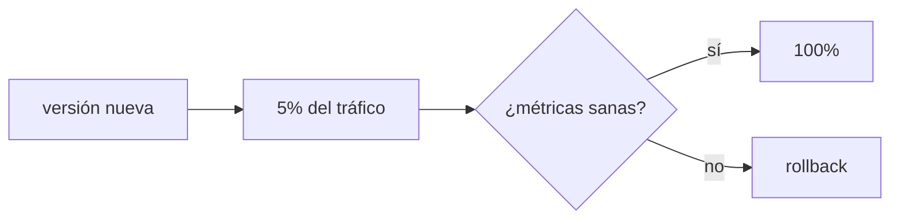

## Cambiar la versión sin tumbar el servicio

Actualizar significa reemplazar la versión que sirve tráfico. Cómo lo haces decide cuánta gente ve un fallo si algo sale mal.

Las cuatro estrategias que siguen son formas distintas de hacer una misma operación: cambiar a dónde apunta el tráfico. Quien la ejecuta es el proxy o el balanceador que tienes delante, así que conviene tener claro [qué hace esa pieza](/deployment/load-balancing/) antes de elegir.

## Cuatro estrategias

- **Recreate**: apaga la vieja, enciende la nueva. Simple, pero hay downtime.
- **Rolling**: reemplaza instancias de a poco. Sin downtime, pero conviven dos versiones un rato.
- **Blue-green**: dos entornos completos (azul actual, verde nuevo); cambias el tráfico de golpe y puedes volver al azul al instante.
- **Canary**: la versión nueva recibe primero una fracción del tráfico; si [las métricas](/scaling/observability/) están sanas, subes; si no, la retiras.

## Elegir según el riesgo

| Estrategia | Downtime | Costo | Rollback |
| --- | --- | --- | --- |
| Recreate | Sí | Bajo | Redesplegar la anterior |
| Rolling | No | Bajo | Rolling inverso |
| Blue-green | No | Alto (2x) | Cambiar el tráfico al azul |
| Canary | No | Medio | Retirar el canary |

No hay una mejor: un blog personal tolera recreate; un servicio de pagos quiere canary con rollback ensayado.

## El rollback es parte del plan

Un despliegue sin rollback es una apuesta. Antes de lanzar, responde: ¿cómo vuelvo a la versión anterior, en cuánto tiempo, y qué pasa con los datos ya migrados? Un rollback que nadie ensayó no existe.

:::caution[Las migraciones de datos no siempre revierten]
Cambiar código es reversible; borrar una columna, no. Diseña cambios de esquema compatibles hacia atrás (agrega antes de quitar) para que un rollback de código no deje datos huérfanos.
:::

## Comprueba lo que entendiste

Un servicio de pagos necesita cero downtime y contener el impacto de un fallo. ¿Qué estrategia?

Canary: expones la versión nueva a una fracción del tráfico y observas métricas antes de subir. Si algo falla, solo afecta a ese porcentaje y retiras el canary. Blue-green también evita downtime, pero canary limita mejor el radio de impacto.

Tu rollback de código funciona, pero el despliegue borró una columna de la base. ¿Qué salió mal?

La migración no era compatible hacia atrás. El código revierte, pero el dato no vuelve solo. Haz los cambios de esquema en pasos compatibles (agrega antes de quitar) para que un rollback de código no deje la base inconsistente.

## Sigue explorando

- [Deployments (Kubernetes)](https://kubernetes.io/docs/concepts/workloads/controllers/deployment/) — rolling updates en la práctica.
- [Canary release (Martin Fowler)](https://martinfowler.com/bliki/CanaryRelease.html)
- [Blue-green deployment (Martin Fowler)](https://martinfowler.com/bliki/BlueGreenDeployment.html)
