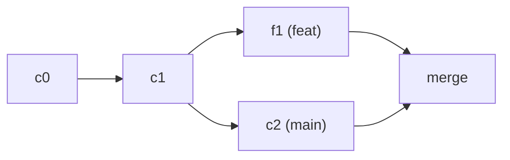

## Why Git

Version control answers three questions no folder of dated backups can: what changed, who changed it, and why. Git won out over what came before on two concrete decisions:

- **It is distributed.** Cloning a repository gives you the entire history, not a link to a server. You can read the log, branch, and commit with no connection, and there is no single copy whose loss is catastrophic.
- **Branching is cheap.** Creating a branch writes a file holding one commit id; nothing is copied. That is what makes the rest of this module's workflow possible: one branch per change, reviewed on its own, thrown away once merged.

And it is now the de facto standard: GitHub, GitLab, and the rest are services built **on top of** Git. Git is the tool running on your machine; GitHub is a place to host a copy and collaborate around it.

A **repository** is a folder with a `.git` subdirectory inside it, holding the project's entire history. There are two ways to get one:

```bash
git init                                 # start a new one here
git clone https://github.com/user/repo   # take a full copy of someone else's
```

## Three objects explain most of it

Git stores connected snapshots:

- A **commit** describes a full state and points to its parent.
- A **branch** is a moving reference that names a line of commits.
- `HEAD` tells you where you are working now.



You can inspect the map without changing it:

```bash
git status
git log --oneline --graph --decorate --all
git show --stat HEAD
```

## The diff is the unit of conversation

A commit does not pick up everything you touched: it picks up what you chose to include. Between your files and the commit there is an intermediate step, the **staging area**, where `git add` places the changes you actually want to keep. That is why there are two different diffs:

```bash
git diff           # what you changed and have not staged
git diff --cached  # exactly what will enter the next commit
```

That distinction keeps an accidental fix from travelling unseen. A useful commit answers one question: what changed and why. Prefer several small changes over one huge change; a message such as `fix: handle empty config` communicates intent, `changes` does not.

## Integrating: merge or rebase

There are two ways to bring one branch's work into another:

- **merge** creates a commit that joins two lines and preserves history as it happened.
- **rebase** replays your commits onto another base and produces a linear history, but rewrites their identifiers.

```bash
git switch feat/health
git merge main       # brings main into your branch with a merge commit
git rebase main      # or replays your commits onto main (linear history)
```

Rule of thumb: **rebase private history, merge shared history.** Rewriting commits others already have creates confusion.

When two branches change the same line, a **conflict** appears. Git marks the file and stops so you can decide:

```text
<<<<<<< HEAD
timeout = 30
=======
timeout = 60
>>>>>>> feat/health
```

You edit the file, choose the correct result, remove the markers and then `git add` to continue. A conflict is not an error: it is Git asking for a decision it cannot make for you.

## What not to version

Not everything belongs in the repository. Secrets, dependencies and build artifacts are excluded with `.gitignore`:

```text
node_modules/
.env
dist/
```

A clean repository makes the diff mean something.

## Remotes and trust

A remote points to another repository copy. `fetch` brings information in; `pull` combines it with your local branch. Separating the two makes it visible when you are reading and when you are integrating.

```bash
git fetch origin
git log --oneline HEAD..origin/main   # what does origin have that I do not?
```

## Check your understanding

<details>
<summary>You are on a branch only you have. To update it with main, merge or rebase?</summary>

Rebase is fine: the history is private, so rewriting it affects no one and you get a clean line to keep building on. If the branch is already shared, prefer merge so you do not rewrite commits others have.

</details>

<details>
<summary>Git stopped with CONFLICT. What should you NOT do?</summary>

Do not delete the `<<<<<<<` markers blindly or force the merge. Open the file, decide which version or combination is correct, remove the markers, and only then `git add` the resolved file before continuing.

</details>

## Keep exploring

- [Pro Git (free book)](https://git-scm.com/book/en/v2) — chapters 2 and 3 cover this in depth.
- [Learn Git Branching](https://learngitbranching.js.org/) — visualize branches and merges interactively.
- `git help glossary` — the exact vocabulary of each object.
