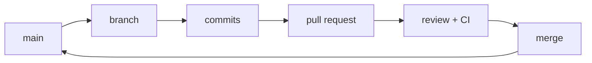

## The flow in five movements



The main branch represents the state a team is willing to share. A working branch creates temporary space for one concrete intention.

```bash
git switch main
git pull --ff-only
git switch -c feat/health-check
```

## Pull requests as conversation

A pull request is not only a merge button. It is a surface for explaining:

1. Which problem the change solves.
2. Which decisions the implementer made.
3. How the change was verified.
4. Which risk remains.

Link the issue that motivates it (for example, with `Closes #42`) so the context travels with the change. The description and diff should make a review specific: "the endpoint returns 503 when the dependency is missing, and the test covers that case" helps more than "looks good".

## Reviewing is reading with intent

A reviewer does not chase formatting errors —automation does that. They look for three things:

- **Correctness**: does the change do what it says and cover the edge cases?
- **Scope**: does the diff contain a single intention?
- **Reversibility**: can it be undone without dragging other things along?

Requesting changes is not a rejection, it is part of the conversation. A small PR gets truly reviewed; a huge one gets approved at a glance, which is worse.

## CI and protected branches

Automation removes repetitive checks: formatting, types, tests and builds. When a check fails, its status should be actionable and point to evidence.

A **protected branch** turns those agreements into rules: require at least one review, require CI to pass and prevent pushing directly to `main`. That way the only gate into the shared state is a change that was reviewed and verified.

:::caution Do not mix cleanup with a feature
A pull request that changes behaviour, renames files and reformats the whole project costs more to review. Split the intent so the signal stays clear.
:::

## Check your understanding

<details>
<summary>Your PR touches 40 files: the feature and a massive reformat. Why is that a problem?</summary>

Because it mixes two intentions and the review loses signal: the real changes hide among thousands of lines of formatting. Split them into two PRs (or two clear commits) so each decision can be reviewed and reverted on its own.

</details>

<details>
<summary>CI fails on your PR and the branch is protected. Can you merge anyway?</summary>

No, and that is the point: the protection requires checks to pass before integrating into main. Fix the cause —the status should point to the evidence— and re-run; only then is the merge enabled.

</details>

## Keep exploring

- [GitHub Flow (official guide)](https://docs.github.com/en/get-started/using-github/github-flow) — the flow in its canonical form.
- [Conventional Commits](https://www.conventionalcommits.org/) — structured commit messages.
- [Protected branches](https://docs.github.com/en/repositories/configuring-branches-and-merges-in-your-repository/managing-protected-branches) — rules to protect main.
