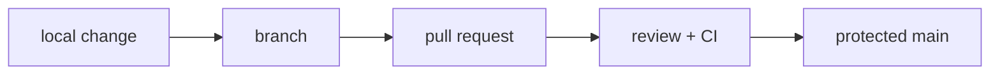

**Where you are:** in Foundations you learned to read a machine. Here the change stops being only yours: a team enters, and with it the need for your work to be reviewable, explainable, and undoable.

## Delivery is also coordination

A software change does not end when it works on your machine. It needs a history another person can read, a place to review intent and a way to go back.

Git provides the local map; collaboration adds agreements: small branches, purposeful commits, review and a protected main branch.

## From your machine to the shared state

## The route

| Moment | Question | Page |
| --- | --- | --- |
| Model | What does a commit represent? | [The Git model](./git-model/) |
| Change | How do I work without stepping on main? | [GitHub Flow](./github-flow/) |
| Review | What should another person understand? | [GitHub Flow](./github-flow/) |
| Practice | Can I create and undo a safe change? | [Practice · safe branches](./lab-git-branching/) |

:::note[History is an interface]
A useful history does not record every keystroke. It records decisions that are small, coherent and reversible.
:::

## What you can do with this

These pages let you create an intentional branch, keep it current, explain a diff and open a change another person can review without rebuilding your context from scratch.
