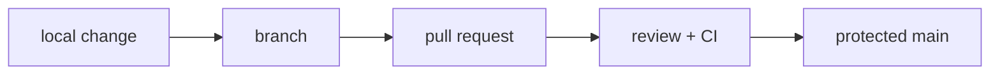

**Where you are:** in Foundations you learned to read a machine. Here the change stops being only yours: a team enters, and with it the need for your work to be reviewable, explainable, and undoable.

## Delivery is also coordination

A software change does not end when it works on your machine. It needs a history another person can read, a place to review intent and a way to go back.

Git provides the local map; collaboration adds agreements: small branches, purposeful commits, review and a protected main branch.

## From your machine to the shared state

## The route

| Moment | Question | Page |
| --- | --- | --- |
| Model | What does a commit represent? | [The Git model](/en/collaboration/git-model/) |
| Review | How do I propose a change another person can review? | [Pull requests and review](/en/collaboration/pull-requests/) |
| Practice | Can I create and undo a safe change? | [Practice · safe branches](/en/collaboration/lab-git-branching/) |

:::note[History is an interface]
A useful history does not record every keystroke. It records decisions that are small, coherent and reversible.
:::

## What this covers

These pages cover how to create an intentional branch, keep it current, read a diff and open a change another person can review without rebuilding your context from scratch.

## Where this breaks

| Symptom | What causes it | Where it continues |
| --- | --- | --- |
| The change is reviewed and still fails when installed on another machine | The code travels alone, without the runtime version or the libraries it needs | [Containers](/en/containers/) |
| Reviewers have to run the code to find out whether it works | No automated check answers that question first | [Continuous integration](/en/integration/) |
| Nobody knows whether a branch may live three days or three weeks | The team never decided on a branching model, so everyone uses their own | [Branching strategies](/en/integration/branching-strategy/) |
