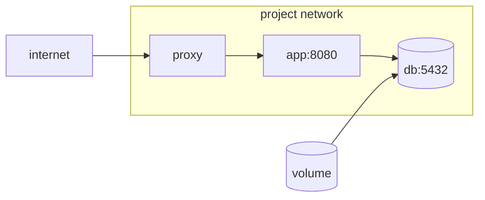

## One file instead of a sequence

An application is usually several containers that have to find each other. With `docker run` that means remembering the order, the names, the network and every flag of every start — and getting them right again tomorrow.

**Docker Compose** swaps that sequence for a description. You write how the set should end up, and `docker compose up` brings it to that state.

```yaml
services:
  app:
    build: .
    environment:
      DATABASE_URL: postgres://atlas:${DB_PASSWORD}@db:5432/atlas
    depends_on:
      db:
        condition: service_healthy
    ports:
      - "127.0.0.1:8080:8080"     # reachable only from the machine itself

  db:
    image: postgres:17
    environment:
      POSTGRES_USER: atlas
      POSTGRES_PASSWORD: ${DB_PASSWORD}
    volumes:
      - db-data:/var/lib/postgresql/data
    healthcheck:
      test: ["CMD-SHELL", "pg_isready -U atlas"]
      interval: 5s
      retries: 5

volumes:
  db-data:
```

```bash
docker compose up -d        # bring it up in the background
docker compose ps           # what is running, and how healthy
docker compose logs -f app  # follow one service's logs
docker compose down         # stop and remove containers and network
```

## They find each other by name

Compose creates a network for the project and gives each service a name resolvable inside it. That is why the application connects to `db:5432` without knowing any IP, and why `db` publishes **no** port: nobody outside needs to reach it.



Note the application's `ports`: `"127.0.0.1:8080:8080"` and not `"8080:8080"`. The second form publishes the port on every interface of the machine, firewall included, and leaves your application reachable without going through the proxy.

:::caution[Publishing a port bypasses ufw]
Docker writes its own rules underneath the firewall. A `ports: "5432:5432"` on your database exposes it to the internet even though `ufw status` shows no such port open. The safe rule is to publish only what the proxy needs, and always with `127.0.0.1:` in front.
:::

## Data goes in volumes

Everything a container writes to its own filesystem dies with it. Since deleting and recreating containers is the normal operation, any data that matters has to live in a **volume**, which Docker manages separately and which survives `docker compose down`.

```bash
docker volume ls                    # which volumes exist
docker compose down                 # removes containers; the volume stays
docker compose down --volumes       # removes the data too
```

That second form is the one that deletes the database. Worth knowing before typing it out of habit.

There are two ways to mount storage and they get confused:

- **Named volume** (`db-data:/var/lib/postgresql/data`): Docker decides where it lives and manages it. This is the right one for data.
- **Bind mount** (`./src:/app/src`): mounts a folder of yours inside the container. Useful in development to see changes without rebuilding; a bad idea in production, because the content then depends on the host machine.

## Started is not ready

`depends_on` in its simple form only waits for the container to **exist**, not for the service inside to accept connections. PostgreSQL takes a few more seconds to be ready, and in that gap your application tries to connect and dies.

There are two answers and it is worth having both:

1. A `healthcheck` on the service you depend on, plus `condition: service_healthy` on the one depending — which is what the example above does.
2. Having the application retry the connection. That is the only one that also protects you when the database restarts with the system already running.

## One file, several environments

The same set needs different things on your machine and on the server. Compose merges files: the second overrides whatever it declares.

```bash
docker compose -f compose.yml -f compose.prod.yml up -d
```

The values that differ between environments — passwords, domains, image tags — move to a `.env` file that is not versioned, and the YAML references them with `${DB_PASSWORD}`. The Compose file can live in the repository; the values cannot.

## Keep exploring

- [Compose · specification](https://docs.docker.com/reference/compose-file/) — every key in the file, with its valid values.
- [Compose · volumes](https://docs.docker.com/engine/storage/volumes/) — named volumes against bind mounts.
