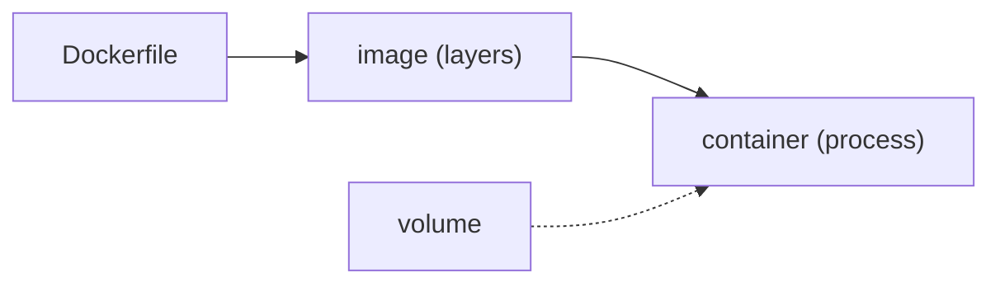

## Why containers and not virtual machines

The problem they solve is an old one: "it works on my machine". The application depends on a Node version, a system library, an environment variable, a file somebody left on the server two years ago. None of that travels with the code.

A **virtual machine** solves it by taking the whole machine along: it virtualises hardware and boots its own kernel with its own operating system. It works, but it costs gigabytes and a minute of boot time.

A **container** takes only what the application needs — its files, its dependencies, its configuration — and shares the host's kernel. What isolates it is not simulated hardware: it is features of Linux itself that give the process its own view of the filesystem, the network, and the process list. That is why it weighs megabytes and starts in milliseconds.

That trade has two practical consequences:

- A container is a Linux process, so it needs a Linux kernel underneath. On macOS and Windows, Docker boots a small virtual machine to run them in.
- The isolation is thinner than a virtual machine's: sharing a kernel means separating less. For running code you do not trust, the virtual machine is still the strong boundary.

## An image and a container are not synonyms

An **image** is an immutable package of layers. A **container** is a process created from that image with a concrete runtime environment.



```bash
docker build -t myapp:local .
docker run --rm -p 127.0.0.1:8080:8080 myapp:local
```

The tag helps you find an image; it does not make `latest` a reliable version: `latest` is a name someone can repoint at a different image tomorrow. Production needs an identifier that does not move, and there are two that get confused because both are called "SHA":

- The image **digest** (`myapp@sha256:9f2c…`) is the cryptographic fingerprint of its content. It is truly immutable: change one byte and the digest changes.
- A **tag carrying the commit SHA** (`myapp:sha-abc123`) says which code the image came from. It is still a tag, so technically it can be repointed; what makes it reliable is the convention that the pipeline writes it once and nobody reuses it.

The usual choice is deploying by the commit tag, which reads well and can be traced, and reaching for the digest when you need the strict guarantee.

Images are not copied between machines by hand: they are published to a **registry** (Docker Hub, GitHub Container Registry, your cloud's own), which works as a remote repository for images. `docker push` uploads and `docker pull` downloads, and that is how an artifact built in CI reaches the server.

## Writing a Dockerfile

A `Dockerfile` describes, step by step, how the image is built. Each instruction creates a **layer**:

```dockerfile
# base image
FROM node:22-alpine
WORKDIR /app

# dependencies first: they change rarely
COPY package.json package-lock.json ./
RUN npm ci --omit=dev

# then the code, which changes daily
COPY . .

# the process does not run as root
USER node
EXPOSE 8080
CMD ["node", "server.js"]
```

Comments go on their own line: a `#` after an instruction is not a comment, it is part of its arguments.

Order matters: copying `package.json` first lets Docker **reuse** that layer while the dependencies do not change, even when you edit the code. Copying everything at once would invalidate the cache on every change.

## Layers and cache

Docker builds top to bottom and caches each layer. If an instruction and its inputs did not change, it reuses the result. That is why dependencies come before code: you change code daily, dependencies rarely.

## Multi-stage: build big, ship small

One stage compiles and another, minimal one runs. The final image does not carry build tooling:

```dockerfile
FROM node:22-alpine AS build
WORKDIR /app
COPY package.json package-lock.json ./
RUN npm ci
COPY . .
RUN npm run build

FROM nginx:alpine
COPY --from=build /app/dist /usr/share/nginx/html
```

The final image contains only nginx and the static files: smaller size, less surface, fewer surprises.

## The container contract

Before running an image, define which process starts, which port it listens on, which configuration it receives, which data must survive and how its health is verified. Data that must persist does not live inside the container: it goes in a **volume**.

```bash
docker run --rm -v myapp-data:/var/lib/app myapp:local
```

If you delete the container, the `myapp-data` volume is still there. A container is disposable; its data should not be.

## Networks and names

On a Docker network, services find one another by name: a container can call `http://app:8080` without knowing its IP. That is why you do not need to publish every port to the host. The usual pattern puts a [reverse proxy](/en/server/proxy-tls/) in front: it is the only one exposed to the outside, and it reaches the rest by service name.

That arrangement is declared in a **Docker Compose** file, which describes several containers and the network they share instead of chaining `docker run` commands. How it is written, and what happens to the data when those containers are recreated, is in [Several containers with Compose](/en/containers/compose/).

:::caution[Less surface, fewer surprises]
A service that only needs to be reachable through the proxy should not publish `80:80` to the host. Expose only what the system contract requires.
:::

## Check your understanding

<details>
<summary>You change one line of code and the build rebuilds ALL dependencies. What is wrong?</summary>

You probably copy the whole project with `COPY . .` before installing, so any code change invalidates the install layer. Copy `package.json` and the lockfile first, install, and only then copy the rest of the code.

</details>

<details>
<summary>You delete the container and lose the database. How do you avoid it?</summary>

Data that must persist goes in a volume (`-v name:/path`), not inside the container. The container is disposable; the volume survives its deletion and can be mounted into a new one.

</details>

## Keep exploring

- [Dockerfile reference](https://docs.docker.com/reference/dockerfile/) — every instruction and its effect.
- [Docker · build cache](https://docs.docker.com/build/cache/) — how layers are reused.
- [Play with Docker](https://labs.play-with-docker.com/) — a free in-browser environment.
