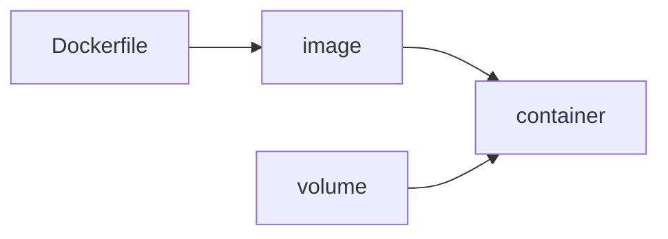

**Where you are:** in One server you installed by hand everything the application needs: the runtime, the dependencies, the configuration. Here that list stops living on one machine and starts travelling with the application, so it runs the same on your laptop as on a server you have never seen.

## The problem packaging solves

An application is its code and also the runtime version, the system libraries, the environment variables, and the order everything was installed in. Installing that by hand on each machine produces servers that are similar but never identical, and the differences surface exactly when something breaks.

A container pins that whole list into a package built once and run anywhere. What the machine happened to have installed before stops mattering.

## Three words you will read a lot

- **Image**: the immutable package, made of layers, holding the application and everything it needs to start. Identified by tag, and in production by its SHA.
- **Container**: the process created from an image, with its own runtime environment. It is disposable: deleting it and creating another is the normal operation.
- **Volume**: storage that lives outside the container and survives its deletion. That is where the data you cannot lose goes.

## From image to process

The `Dockerfile` describes how the image is built. The image does not change. The container does: it is born, writes to its own temporary layer, and dies. Anything that must survive that death has to be in a volume.

## The route

| Moment | Question | Page |
| --- | --- | --- |
| Package | What is an image and how is it built? | [Docker without magic](/en/containers/docker/) |
| Set | How do I describe several containers and their data? | [Several containers with Compose](/en/containers/compose/) |
| Practice | Can I package an application and explain why it does not answer? | [Practice · packaging myapp](/en/containers/lab-container-pipeline/) |

:::note[A container is not a virtual machine]
It does not carry its own operating system: it shares the host kernel and only isolates the process, its files, and its network. That is why it starts in milliseconds and weighs megabytes instead of gigabytes.
:::

## What this covers

These pages cover how to write a `Dockerfile`, build an image, describe the service with Compose, and where the data ends up once the container is gone.

## Where this breaks

| Symptom | What causes it | Where it continues |
| --- | --- | --- |
| The image is built by hand and each person builds it differently | Nothing but your machine knows how to produce the package | [Continuous integration](/en/integration/) |
| The image was built from code nobody checked | There is no verification between the commit and the package | [Tests in CI](/en/integration/tests-in-ci/) |
| The artifact exists, but reaching the server is still manual | The package is there and the route to production is not | [From build to release](/en/deployment/pipeline/) |
