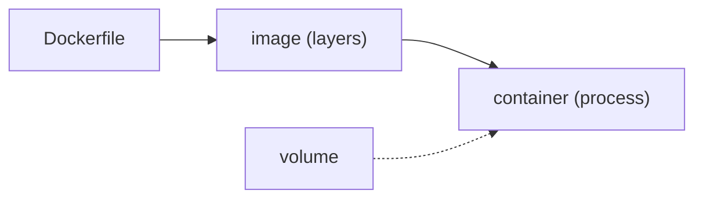

## An image and a container are not synonyms

An **image** is an immutable package of layers. A **container** is a process created from that image with a concrete runtime environment.



```bash
docker build -t atlas-web:local .
docker run --rm -p 8080:80 atlas-web:local
```

The tag helps you find an image; it does not make `latest` a reliable version: `latest` is a name someone can repoint at a different image tomorrow. Production uses an **immutable** identifier instead, usually the **SHA**: the cryptographic fingerprint of the image's content. Change the content and the fingerprint changes, so `sha-abc123` always means exactly the same bytes.

Images are not copied between machines by hand: they are published to a **registry** (Docker Hub, GitHub Container Registry, your cloud's own), which works as a remote repository for images. `docker push` uploads and `docker pull` downloads, and that is how an artifact built in CI reaches the server.

## Writing a Dockerfile

A `Dockerfile` describes, step by step, how the image is built. Each instruction creates a **layer**:

```dockerfile
FROM node:22-alpine                    # base image
WORKDIR /app                           # working directory
COPY package.json pnpm-lock.yaml ./    # dependencies first
RUN corepack enable && pnpm install --frozen-lockfile
COPY . .                               # then the code
RUN pnpm run build                     # produces /app/dist
EXPOSE 8080
CMD ["node", "server.js"]              # the process the container starts
```

Order matters: copying `package.json` first lets Docker **reuse** that layer while the dependencies do not change, even when you edit the code. Copying everything at once would invalidate the cache on every change.

## Layers and cache

Docker builds top to bottom and caches each layer. If an instruction and its inputs did not change, it reuses the result. That is why dependencies come before code: you change code daily, dependencies rarely.

## Multi-stage: build big, ship small

One stage compiles and another, minimal one runs. The final image does not carry build tooling:

```dockerfile
FROM node:22-alpine AS build
WORKDIR /app
COPY . .
RUN corepack enable && pnpm install --frozen-lockfile && pnpm run build

FROM nginx:alpine
COPY --from=build /app/dist /usr/share/nginx/html
```

The final image contains only nginx and the static files: smaller size, less surface, fewer surprises.

## The container contract

Before running an image, define which process starts, which port it listens on, which configuration it receives, which data must survive and how its health is verified. Data that must persist does not live inside the container: it goes in a **volume**.

```bash
docker run --rm -v atlas-data:/var/lib/app atlas-web:local
```

If you delete the container, the `atlas-data` volume is still there. A container is disposable; its data should not be.

## Networks and names

On a Docker network, services find one another by name. You do not need to publish every port to the host. If Caddy and an application share an external network, Caddy routes internally to the service name.

```yaml
services:
  atlas:
    image: ghcr.io/example/devops-atlas:sha-abc123
    networks: [caddy-net]

networks:
  caddy-net:
    external: true
```

:::caution[Less surface, fewer surprises]
A service that only needs to be reachable through Caddy should not publish `80:80` to the host. Expose only what the system contract requires.
:::

## Check your understanding

<details>
<summary>You change one line of code and the build rebuilds ALL dependencies. What is wrong?</summary>

You probably copy the whole project with `COPY . .` before installing, so any code change invalidates the install layer. Copy `package.json` and the lockfile first, install, and only then copy the rest of the code.

</details>

<details>
<summary>You delete the container and lose the database. How do you avoid it?</summary>

Data that must persist goes in a volume (`-v name:/path`), not inside the container. The container is disposable; the volume survives its deletion and can be mounted into a new one.

</details>

## Keep exploring

- [Dockerfile reference](https://docs.docker.com/reference/dockerfile/) — every instruction and its effect.
- [Docker · build cache](https://docs.docker.com/build/cache/) — how layers are reused.
- [Play with Docker](https://labs.play-with-docker.com/) — a free in-browser environment.
