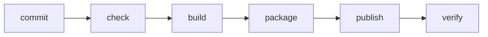

## Delivery reduces uncertainty

A pipeline does not exist to look automated. It turns a small intention into evidence: code can be installed, tested, packaged and published under known conditions.

## The delivery chain

Docker makes the package visible. GitHub Actions makes the route repeatable. Feedback from each stage should arrive quickly and explain what failed.

## Module map

| Signal | What you will learn | Page |
| --- | --- | --- |
| Package | What it means to encapsulate an application | [Docker without magic](./docker/) |
| Workflow | How to express an automated check | [GitHub Actions](./github-actions/) |
| Evidence | How to verify a local image | [Pipeline lab](./lab-container-pipeline/) |

:::note Deployment starts before the server
A VPS should not be the first place where you discover that the application does not build. The server receives artifacts that already passed cheap, repeatable controls.
:::

## Expected outcome

You will be able to build a local image, describe pipeline stages and distinguish source code, artifact and runtime environment.
