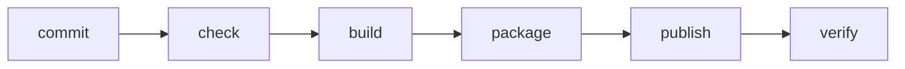

**Where you are:** in Collaboration a change became reviewable. Here it becomes installable: built, packaged, and checked on its own, the same way every time.

## Delivery reduces uncertainty

A pipeline does not exist to look automated. It turns a small intention into evidence: code can be installed, tested, packaged and published under known conditions.

## Three words you will read a lot

- **Pipeline**: the automated sequence of stages a change travels from commit to published. Each stage leaves evidence and can stop the change from going further.
- **Artifact**: the packaged result of a build — a container image, a `.jar`, a folder of static files. It is what gets deployed, and it is not the same thing as the code it came from.
- **Environment**: a complete installation of the system, with its own configuration and its own data. Three is the common setup — development, staging, and **production** — and only the last one has real users.

## The delivery chain

Docker makes the package visible. GitHub Actions makes the route repeatable. Feedback from each stage should arrive quickly and explain what failed.

## Module map

| Signal | What you will learn | Page |
| --- | --- | --- |
| Package | What it means to encapsulate an application | [Docker without magic](./docker/) |
| Workflow | How to express an automated check | [GitHub Actions](./github-actions/) |
| Evidence | How to verify a local image | [Practice · local pipeline](./lab-container-pipeline/) |

:::note[Deployment starts before the server]
The server should not be the first place where you discover that the application does not build. The server receives artifacts that already passed cheap, repeatable controls.
:::

## Expected outcome

You will be able to build a local image, describe pipeline stages and distinguish source code, artifact and runtime environment.
