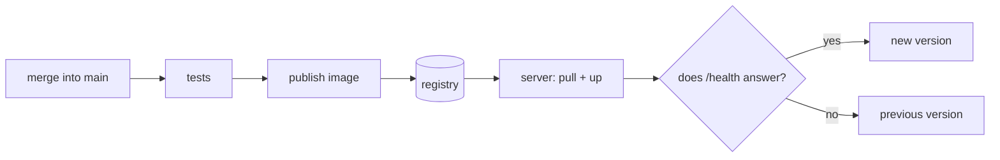

## The missing stretch

So far there are two halves that never touch. On one side, a workflow that tests the code and builds the image. On the other, a server someone logs into over SSH to update it. This page joins them: merging into `main` is what deploys.



Every manual step from [Deploying by hand](/en/server/manual-deploy/) has a replacement here:

| By hand | In the pipeline |
| --- | --- |
| Installing the runtime on the server | It travels inside the image |
| `git pull` and installing dependencies | The server downloads an image that is already built |
| Restarting the service | `docker compose up` with the new tag |
| Opening the site to see whether it works | A request to `/health` that decides whether the deployment counts |
| Remembering what was there before | The previous tag is saved before switching |

## Publishing the image

The CI workflow already builds the image in order to test it. On a merge into `main` it also has to be left in a **registry**, under a name that cannot be mistaken for another: the commit SHA.

```yaml
  publish:
    needs: [test, image]
    if: github.event_name == 'push' && github.ref == 'refs/heads/main'
    runs-on: ubuntu-latest
    permissions:
      contents: read
      packages: write
    steps:
      - uses: actions/checkout@v4
      - uses: docker/login-action@v3
        with:
          registry: ghcr.io
          username: ${{ github.actor }}
          password: ${{ secrets.GITHUB_TOKEN }}
      - uses: docker/build-push-action@v6
        with:
          context: .
          push: true
          tags: ghcr.io/${{ github.repository }}:sha-${{ github.sha }}
          build-args: APP_VERSION=${{ github.sha }}
```

Three decisions in that block:

- **The `if`** limits publishing to what is already merged. A pull request gets tested, but publishes nothing.
- **`packages: write` on this job only.** The rest of the workflow can still do no more than read the code.
- **`GITHUB_TOKEN`** is the credential GitHub issues for that run and it expires with it. No personal token is stored anywhere.

So the application knows which version it is, the `Dockerfile` receives the SHA at build time:

```dockerfile
ARG APP_VERSION=dev
ENV APP_VERSION=$APP_VERSION
```

:::note[The image name is lowercase]
A registry rejects names with capital letters. If your user or repository has them, write the name by hand instead of using `github.repository`.
:::

## What lives on the server

The server stops holding code. It holds a Compose file that says which image to run, and a variable decides that image:

```yaml
# deploy/compose.yml — in the repository; the pipeline copies it to /opt/myapp
services:
  app:
    image: ${MYAPP_IMAGE:?MYAPP_IMAGE is missing}
    ports:
      - "127.0.0.1:8080:8080"
    restart: unless-stopped
```

The nginx from [Reverse proxy and certificates](/en/server/proxy-tls/) does not change: it keeps forwarding to `127.0.0.1:8080`, and does not care whether a systemd process or a container listens there. What is no longer needed is the `myapp.service` unit: `restart: unless-stopped` does that job now.

The version switch is a script, also in the repository:

```bash
#!/usr/bin/env bash
# deploy/deploy.sh — usage: deploy.sh <image>
set -euo pipefail
cd /opt/myapp

image="$1"
previous="$(grep -s '^MYAPP_IMAGE=' .env | cut -d= -f2- || true)"

printf 'MYAPP_IMAGE=%s\n' "$image" > .env
docker compose pull
docker compose up --detach

for attempt in 1 2 3 4 5 6 7 8 9 10; do
  if curl --fail --silent http://127.0.0.1:8080/health > /dev/null; then
    echo "deployed: $image"
    exit 0
  fi
  sleep 2
done

echo "the new version does not answer; going back to ${previous:-nothing}" >&2
if [ -n "$previous" ]; then
  printf 'MYAPP_IMAGE=%s\n' "$previous" > .env
  docker compose up --detach
fi
exit 1
```

The order is the point. It reads the version that was there **before** touching anything. It switches. It checks for twenty seconds. If nothing answers, it writes the previous tag back and exits with an error, so the workflow ends red even though the service is standing again.

## The job that deploys

```yaml
  deploy:
    needs: publish
    runs-on: ubuntu-latest
    environment: production
    concurrency: deploy-production
    env:
      IMAGE: ghcr.io/${{ github.repository }}:sha-${{ github.sha }}
      TARGET: ${{ vars.DEPLOY_TARGET }}        # deploy@203.0.113.10
    steps:
      - uses: actions/checkout@v4
      - name: Prepare SSH
        env:
          SSH_KEY: ${{ secrets.DEPLOY_SSH_KEY }}
          KNOWN_HOSTS: ${{ secrets.DEPLOY_KNOWN_HOSTS }}
        run: |
          install -m 700 -d ~/.ssh
          printf '%s\n' "$SSH_KEY" > ~/.ssh/id_ed25519
          printf '%s\n' "$KNOWN_HOSTS" > ~/.ssh/known_hosts
          chmod 600 ~/.ssh/id_ed25519
      - name: Copy the definition
        run: scp deploy/compose.yml deploy/deploy.sh "$TARGET:/opt/myapp/"
      - name: Switch version
        run: ssh "$TARGET" "bash /opt/myapp/deploy.sh '$IMAGE'"
      - name: Check from outside
        run: curl --fail --silent --show-error --retry 5 --retry-delay 3 https://your-domain.com/health
```

- **`environment: production`** lets you require an approval before the job starts, and is where that environment's secrets are stored. With approval it is continuous delivery; without it, continuous deployment.
- **`concurrency`** stops two deployments from running at once and overwriting each other's `.env` file.
- **Copying the definition on every deployment** means the server keeps nothing that is not in the repository. If the machine disappears, no decision is lost.
- **The final check goes through the public domain**, not `127.0.0.1`. The script already verified the container; this one verifies the whole path: DNS, certificate, proxy, and application.

## The door that key opens

The pipeline logs into the server, so that credential deserves the same care as any other access:

```bash
# on the server, once
sudo adduser --disabled-password --gecos '' deploy
sudo usermod -aG docker deploy
sudo install -o deploy -g deploy -m 750 -d /opt/myapp
```

```bash
# on your machine: a key pair for this alone
ssh-keygen -t ed25519 -f deploy_key -N '' -C 'github-actions deploy'
ssh-keyscan -t ed25519 203.0.113.10        # its output is DEPLOY_KNOWN_HOSTS
```

The public key goes into `/home/deploy/.ssh/authorized_keys`; the private one into the `DEPLOY_SSH_KEY` secret, and is deleted from your disk.

- **A user of its own**, with no password and no `sudo`. It is not your user or your key: if it leaks, it is revoked without touching your access.
- **A pinned `known_hosts`.** Without it, the runner would accept any server answering at that IP. With it, it only talks to the machine whose fingerprint you stored.
- **The `docker` group is equivalent to `root`** on that machine: whoever can start containers can mount the whole disk. That is acceptable on a server dedicated to this, and it is the reason not to reuse that user for anything else.

:::caution[The server needs permission to download too]
An image in a registry is private unless you say otherwise. Either you make it public — reasonable when the code already is — or the server logs in with a token that can only read packages. Never with the same token that publishes.
:::

## What is left standing when something fails

| Where it fails | What the user sees | What is left |
| --- | --- | --- |
| The tests | Nothing: the previous version carries on | No image was published |
| The publishing | Nothing | The server was not touched |
| The `pull` on the server | Nothing | The previous container keeps running |
| The new container does not answer | A few seconds of downtime | The script went back to the previous image |
| The check through the domain | Depends on the cause | The container is healthy; the fault is in the proxy, the certificate, or DNS |

The fourth row is the limit of this design: `docker compose up` stops the old container before starting the new one, so there is always an instant without service, and a few more seconds if it has to go back. Removing that gap takes both versions running at once and a proxy that switches between them, which is what [Load balancing](/en/deployment/load-balancing/) and [Deployment strategies](/en/deployment/strategies/) are about.

## Keep exploring

- [GitHub · publishing Docker images](https://docs.github.com/en/actions/use-cases-and-examples/publishing-packages/publishing-docker-images) — the full flow to GitHub's registry.
- [GitHub · environments](https://docs.github.com/en/actions/deployment/targeting-different-environments/using-environments-for-deployment) — approvals and secrets per environment.
- [Docker · daemon security](https://docs.docker.com/engine/security/#docker-daemon-attack-surface) — why the `docker` group is equivalent to `root`.
