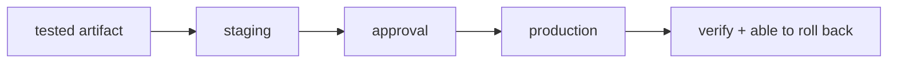

**Where you are:** you have a tested artifact. What is left is the last stretch, and the most visible one: getting it to the server unattended, putting it in front of real users without cutting the service, and being able to go back.

## From integrating to delivering

You already build an artifact and test it in CI. Deploying is the last leg: getting that artifact into a person's hands, under controlled conditions and with an emergency exit.

**Continuous integration (CI)** keeps the code always integrable. **Continuous delivery (CD)** keeps the artifact always deployable, and sometimes deploys it on its own.

## The route

| Moment | Question | Page |
| --- | --- | --- |
| Pipeline | How does an artifact go from build to release? | [From build to release](/en/deployment/pipeline/) |
| Automation | How does the image reach the server without anyone logging in over SSH? | [Deploying from the pipeline](/en/deployment/deploy-from-pipeline/) |
| Traffic | Who decides which instance each request reaches? | [Load balancing](/en/deployment/load-balancing/) |
| Strategy | How do I change the version without taking the service down? | [Deployment strategies](/en/deployment/strategies/) |
| Practice | Can I promote and roll back a version? | [Practice · promote and roll back](/en/deployment/lab-release/) |

:::note[Deploying is not an event, it is a capability]
A mature team does not pray before a yearly deploy. It deploys often, in small portions, and can roll back in minutes.
:::

## What this covers

These pages cover the stages of a delivery pipeline, a deployment that starts from a merge into `main` and goes back if it fails, strategies by risk, and a promotion with rollback.

## Where this breaks

| Symptom | What causes it | Where it continues |
| --- | --- | --- |
| The deployment finishes and nobody knows whether the service is healthy | Evidence stops at the pipeline instead of continuing into production | [Observability](/en/scaling/observability/) |
| A single machine takes all the traffic, and its failure is the service's failure | There is no second instance the balancer could send requests to | [When to scale, and how](/en/scaling/when-to-scale/) |
| The server you deploy to was configured by hand and nobody could rebuild it | The application is automated and the machine holding it up is not | [Infrastructure as code](/en/infrastructure/) |
