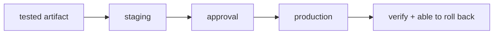

## From integrating to delivering

You already build an artifact and test it in CI. Deploying is the last leg: getting that artifact into a person's hands, under controlled conditions and with an emergency exit.

**Continuous integration (CI)** keeps the code always integrable. **Continuous delivery (CD)** keeps the artifact always deployable, and sometimes deploys it on its own.

## The route

| Moment | Question | Page |
| --- | --- | --- |
| Pipeline | How does an artifact go from build to release? | [From build to release](./pipeline/) |
| Traffic | Who decides which instance each request reaches? | [Reverse proxy and load balancing](./proxy/) |
| Strategy | How do I change the version without taking the service down? | [Deployment strategies](./strategies/) |
| Evidence | How do I know the new version behaves well? | [Observability](./observability/) |
| Practice | Can I promote and roll back a version? | [Practice · promote and roll back](./lab-release/) |

:::note[Deploying is not an event, it is a capability]
A mature team does not pray before a yearly deploy. It deploys often, in small portions, and can roll back in minutes.
:::

## Expected outcome

You will be able to describe a delivery pipeline, choose a deployment strategy by risk, know what to watch in the minutes that follow, and practise a promotion with rollback.
