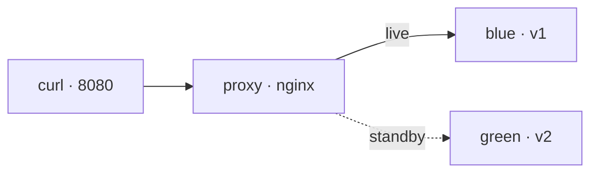

:::note[Written walkthrough, not run end to end]
I have not run this walkthrough from start to finish. The output shown is illustrative and may differ from yours. If a step does not work, [open an issue](https://github.com/mkrebs03/devops-atlas/issues).
:::

## End state

Two versions of `myapp` running at once, an nginx in front deciding which one serves, and a loop of requests showing that switching from one to the other — and back — cuts nothing.



## Requirements

- Docker running.
- The `~/myapp` folder with its `Dockerfile`, from the [containers walkthrough](/en/containers/lab-container-pipeline/).
- Two terminals.
- If your Docker runs in a virtual machine (Colima, Docker Desktop), work inside your home folder, as the walkthrough does: those are the paths the virtual machine can mount.
- About 20 minutes.

## Step 1 · The blue version, behind the proxy

```bash
docker build --tag myapp:local ~/myapp
mkdir -p ~/atlas-bluegreen/conf && cd ~/atlas-bluegreen

docker network create atlas-bg
docker run --detach --name blue --network atlas-bg --env APP_VERSION=v1 myapp:local

cat > conf/default.conf <<'EOF'
server {
  listen 80;
  location / {
    proxy_pass http://blue:8080;
  }
}
EOF

docker run --detach --name proxy --network atlas-bg \
  --publish 127.0.0.1:8080:80 \
  --volume "$PWD/conf:/etc/nginx/conf.d:ro" nginx:alpine

curl -s http://127.0.0.1:8080/
```

`blue` publishes no port. The only container reachable from your machine is the proxy, which reaches `blue` by name inside the `atlas-bg` network.

**Signal:** `myapp v1`.

## Step 2 · Leave traffic running

In the **second terminal**, fire requests non-stop and leave them there for the whole walkthrough:

```bash
while true; do
  curl -sf -m 2 http://127.0.0.1:8080/ || echo FAILED
  sleep 0.3
done
```

**Signal:** a column of `myapp v1`. Any request that did not get a `200` would print `FAILED`.

## Step 3 · The green version, in isolation

```bash
docker run --detach --name green --network atlas-bg --env APP_VERSION=v2 myapp:local
docker run --rm --network atlas-bg alpine wget -qO- http://green:8080/
docker run --rm --network atlas-bg alpine wget -qO- http://green:8080/health
```

**Signal:** `myapp v2` and `{"status":"ok"}` from inside the network, while the second terminal keeps saying `myapp v1`. The new version is deployed and nobody is using it: that is the smoke test before giving it traffic.

## Step 4 · Switch the traffic

```bash
cat > conf/default.conf <<'EOF'
server {
  listen 80;
  location / {
    proxy_pass http://green:8080;
  }
}
EOF

docker exec proxy nginx -t && docker exec proxy nginx -s reload
```

`nginx -t` validates the file; `-s reload` starts new processes with the new configuration and lets the old ones finish the requests they had in hand before exiting.

**Signal:** in the second terminal, the column goes from `myapp v1` to `myapp v2` with no `FAILED` in between.

## Step 5 · A broken change does not reach traffic

Point the proxy at a destination that does not exist:

```bash
cat > conf/default.conf <<'EOF'
server {
  listen 80;
  location / {
    proxy_pass http://purple:8080;
  }
}
EOF

docker exec proxy nginx -t && docker exec proxy nginx -s reload
```

**Signal:** `nginx -t` fails with `host not found in upstream "purple"`, the `&&` prevents the reload, and the second terminal stays on `myapp v2`. The file on disk is broken and the proxy keeps serving with the last valid configuration.

## Step 6 · Roll back

Something went wrong with green. Going back is the same operation, the other way:

```bash
cat > conf/default.conf <<'EOF'
server {
  listen 80;
  location / {
    proxy_pass http://blue:8080;
  }
}
EOF

docker exec proxy nginx -t && docker exec proxy nginx -s reload
```

**Signal:** the column returns to `myapp v1`, again with no `FAILED`. You rebuilt and restarted nothing: `blue` was still there, which is why the rollback takes as long as a reload.

That is also the cost of blue-green: for as long as you want to be able to go back, you pay for both versions running.

## When something does not add up

| Symptom | Likely cause | Command |
| --- | --- | --- |
| Continuous `FAILED` from the start | The proxy did not start | `docker logs proxy` |
| `502 Bad Gateway` when requesting without `-f` | The target container is not running | `docker ps` |
| `host not found in upstream` when starting the proxy | `blue` does not exist or is on another network | `docker network inspect atlas-bg` |
| The reload changes nothing | The file you edited is not the mounted one | `docker exec proxy cat /etc/nginx/conf.d/default.conf` |
| `name is already in use` | Containers were left over from an earlier attempt | The cleanup section |

## Cleanup

Stop the loop in the second terminal with `Ctrl+C`. Then:

```bash
docker rm --force proxy blue green
docker network rm atlas-bg
rm -rf ~/atlas-bluegreen
```
