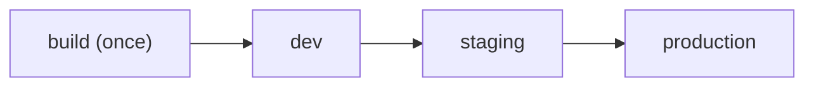

## CI, CD, and CD: three acronyms that are not the same thing

- **Continuous integration**: every change is integrated and validated often.
- **Continuous delivery**: the artifact is always ready to deploy; the move to production is a button.
- **Continuous deployment**: that button is automatic when the checks pass.

The difference between the last two is a **gate**: manual or automatic.

## Build once, promote the same artifact

The classic mistake is rebuilding in each environment. If `staging` and `production` compile separately, you are not testing what you deploy. Build **one** image, tag it with the SHA of the commit it came from, and promote that same image:



```bash
# the same immutable image travels across environments
docker tag myapp:sha-abc123 registry/myapp:sha-abc123
docker push registry/myapp:sha-abc123
```

How that is done from a workflow, and how that image reaches the server, is in [Deploying from the pipeline](/en/deployment/deploy-from-pipeline/).

## Environments gain confidence

Each environment answers a question: does it start? does it pass smoke tests? does it behave with realistic data? Production should not be the first place a version runs.

A **smoke test** is the minimum check that a version is alive: the health endpoint answers, the front page loads, the database connects. It does not replace the test suite; it only rules out having deployed something that does not even start.

An **approval gate** —for example, a protected `environment` in GitHub Actions— makes explicit who authorises the final step.

:::tip[Config per environment, single artifact]
What changes between environments is the configuration (variables, secrets, URLs), not the binary. Same artifact, different config: that way what you tested is what runs.
:::

## Check your understanding

<details>
<summary>Your pipeline builds the image in staging and again in production. What risk do you introduce?</summary>

That you are not deploying what you tested: two builds can differ by dependencies, cache or timing. Build a single image, tag it with the commit SHA and promote that same one to each environment; the config changes, the artifact does not.

</details>

<details>
<summary>What is the difference between continuous delivery and continuous deployment?</summary>

The gate. In continuous delivery the artifact is ready and a person approves the move to production; in continuous deployment that step is automatic when all checks pass.

</details>

## Keep exploring

- [Continuous Delivery (Martin Fowler)](https://martinfowler.com/bliki/ContinuousDelivery.html) — the reference definition.
- [The Twelve-Factor App · config](https://12factor.net/config) — why config belongs per environment.
