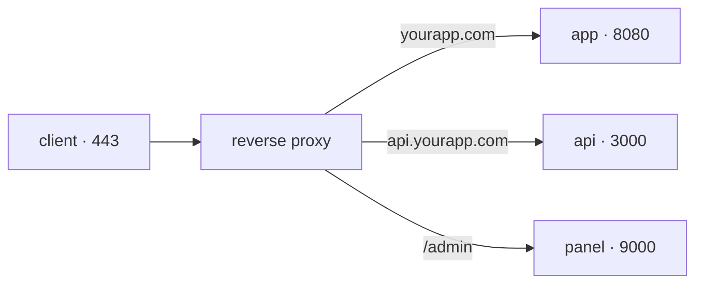

## One 443 for many services

Your server has one IP and one application listening on port 8080. A user's browser knows nothing about that port: it asks for `https://yourapp.com`, which means port 443. And tomorrow you want a second application there, plus an API, plus the admin panel.

They cannot all listen on 443: a port belongs to one process. Something has to sit in front, take all the traffic, and decide where each request goes.



That is a **reverse proxy**: a server that receives requests on behalf of your services and forwards each to the right one. It is called "reverse" because an ordinary proxy represents the client to the internet; this one represents the server to the client, who never learns what is behind it.

## What it buys you

Routing is only the first reason. A reverse proxy concentrates in one place four things you would otherwise solve inside every application:

- **TLS.** The certificate is installed and renewed in a single spot. The proxy decrypts the connection and talks to your services over the internal network. This is called *TLS termination*.
- **Minimal surface.** Your services stop publishing ports to the outside: only the proxy is reachable from the internet, and the rest live on an internal network where they find each other by name.
- **Shared rules.** Size and rate limits, security headers, compression, timeouts: written once, applied to everything behind.
- **A single access log.** Every request passes through the same place, so there is one place to see what is coming in.

```nginx
server {
  listen 443 ssl;
  server_name yourapp.com;

  location / {
    proxy_pass http://app:8080;      # "app" is the service name on the internal network
    proxy_set_header Host $host;
    proxy_set_header X-Forwarded-For $remote_addr;
  }
}
```

Those two headers matter more than they look: without them your application believes every request comes from the proxy rather than from a user, and the logs stop being useful for investigating anything.

:::note[Caddy, Traefik, nginx: the same role]
The syntax differs, and so does how much is automated — Caddy obtains and renews certificates on its own, Traefik configures itself by reading container labels — but all three occupy the same box in the diagram. Choose on operational fit, not on performance: for almost any real load, all three are far more than enough.
:::

## Balancing: several instances of the same service

When one instance cannot keep up, or when you do not want its death to be the service's death, you run several identical copies. Now the proxy has one more decision: **which** of them gets each request. That is **load balancing**.

```nginx
upstream app {
  server app-1:8080;
  server app-2:8080;
  server app-3:8080;
}
```

The default split is by turns (*round robin*): one each, in order. You can also spread by fewest active connections, or pin a client to a specific instance.

But what actually makes a balancer useful is the **health check**: every few seconds it asks each instance whether it is well — usually by requesting an endpoint such as `/health` — and **pulls out of rotation** whichever fails to answer. Without that, a balancer keeps sending traffic to a dead instance and one request in three fails.

```bash
curl -s http://127.0.0.1:8080/health
# {"status":"ok","db":"ok"}
```

Making that endpoint honest is the application's job: if it returns `200` without checking its dependencies, the balancer will keep an instance in rotation that cannot serve anyone.

## Why there are no deployment strategies without this

Here is the underlying reason to read this page before the next one. Deploying without cutting the service always comes down to the same thing: **changing where the traffic points**. All that differs between strategies is what gets touched at the proxy.

| Strategy | What changes at the proxy |
| --- | --- |
| Rolling | Pull one instance out of rotation, update it, put it back; repeat |
| Blue-green | Point the `upstream` block at the new version instead of the old |
| Canary | Split with weights: 95% to the current version, 5% to the new one |

And the rollback is the same operation in reverse, which is what makes it fast: you rebuild nothing, you just point back.

:::caution[Open connections do not vanish on their own]
When you remove an instance, the requests it was already serving are still alive. A deployment without downtime needs *draining*: stop sending it new traffic, wait for it to finish what it has in hand, and only then shut it down.
:::

## State gets in the way

If your application keeps something in its own memory — the session of whoever logged in, a cart, an uploaded file — balancing breaks it: that user's next request lands on another instance that knows nothing about it.

The way out is not pinning each user to an instance, but moving the state out: sessions in a database or in Redis, files in shared storage. An application whose instances are interchangeable is the one you can scale and deploy without ceremony.

## Check your understanding

<details>
<summary>You have three instances and one loses its database. Why do a third of the requests keep failing?</summary>

Because the balancer still considers it healthy. Either no health check is configured, or the endpoint returns `200` without checking its dependencies. A process being alive does not mean it can serve: the check has to verify what the application needs in order to answer.

</details>

<details>
<summary>Why is a blue-green switch almost instant, if the new version takes minutes to boot?</summary>

Because booting and switching traffic are two separate moments. The new version comes up and gets verified calmly while nobody is using it; the deployment itself is only the change of destination at the proxy, which is immediate. And that is why going back is immediate too.

</details>

## Keep exploring

- [nginx · load balancing](https://nginx.org/en/docs/http/load_balancing.html) — the distribution methods and how to configure them.
- [Caddy · reverse_proxy](https://caddyserver.com/docs/caddyfile/directives/reverse_proxy) — the same role with automatic certificates.
- [The Twelve-Factor App · processes](https://12factor.net/processes) — why state does not live inside the process.
