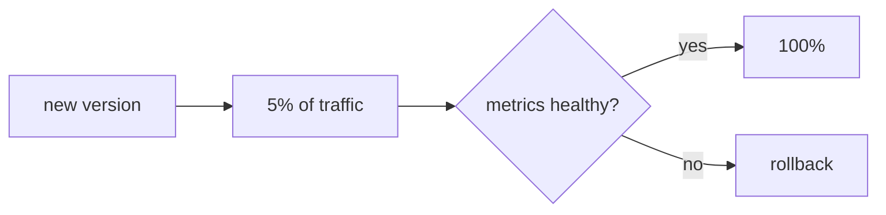

## Changing the version without taking the service down

Updating means replacing the version that serves traffic. How you do it decides how many people see a failure if something goes wrong.

The four strategies below are different ways of performing the same operation: changing where traffic points. The thing that performs it is the proxy or balancer sitting in front, so it pays to be clear on [what that piece does](/en/deployment/load-balancing/) before choosing.

## Four strategies

- **Recreate**: shut the old one down, start the new one. Simple, but there is downtime.
- **Rolling**: replace instances gradually. No downtime, but two versions coexist for a while.
- **Blue-green**: two full environments (blue current, green new); you switch traffic at once and can return to blue instantly.
- **Canary**: the new version first receives a fraction of traffic; if [the metrics](/en/deployment/observability/) are healthy you ramp up, otherwise you withdraw it.

## Choosing by risk

| Strategy | Downtime | Cost | Rollback |
| --- | --- | --- | --- |
| Recreate | Yes | Low | Redeploy the previous one |
| Rolling | No | Low | Reverse rolling |
| Blue-green | No | High (2x) | Switch traffic to blue |
| Canary | No | Medium | Withdraw the canary |

There is no single best: a personal blog tolerates recreate; a payments service wants canary with a rehearsed rollback.

## The rollback is part of the plan

A deployment without a rollback is a bet. Before you launch, answer: how do I return to the previous version, in how long, and what happens to already-migrated data? A rollback nobody rehearsed does not exist.

:::caution[Data migrations do not always revert]
Changing code is reversible; dropping a column is not. Design schema changes that are backward compatible (add before you remove) so a code rollback does not leave orphaned data.
:::

## Check your understanding

A payments service needs zero downtime and must contain the impact of a failure. Which strategy?

Canary: you expose the new version to a fraction of traffic and watch metrics before ramping up. If something fails, it only affects that percentage and you withdraw the canary. Blue-green also avoids downtime, but canary limits the blast radius better.

Your code rollback works, but the deployment dropped a database column. What went wrong?

The migration was not backward compatible. The code reverts, but the data does not come back on its own. Make schema changes in compatible steps (add before you remove) so a code rollback does not leave the database inconsistent.

## Keep exploring

- [Deployments (Kubernetes)](https://kubernetes.io/docs/concepts/workloads/controllers/deployment/) — rolling updates in practice.
- [Canary release (Martin Fowler)](https://martinfowler.com/bliki/CanaryRelease.html)
- [Blue-green deployment (Martin Fowler)](https://martinfowler.com/bliki/BlueGreenDeployment.html)
