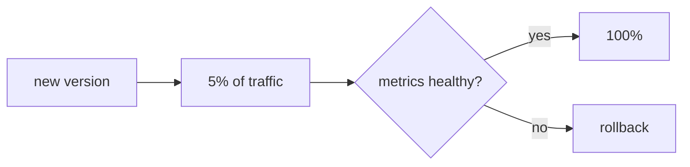

:::note
I have studied blue-green and canary but I have not applied them on a real system. [About this site](/en/about/) lists what I run and what I do not.
:::

## Changing the version without taking the service down

Updating means replacing the version that serves traffic. How you do it decides how many people see a failure if something goes wrong.

The four strategies below are different ways of performing the same operation: changing where traffic points. The thing that performs it is the proxy or balancer sitting in front, so it pays to be clear on [what that piece does](/en/deployment/load-balancing/) before choosing.

## Four strategies

- **Recreate**: shut the old one down, start the new one. Simple, but there is downtime.
- **Rolling**: replace instances gradually. No downtime, but two versions coexist for a while.
- **Blue-green**: two full environments (blue current, green new); you switch traffic at once and can return to blue instantly.
- **Canary**: the new version first receives a fraction of traffic; if [the metrics](/en/scaling/observability/) are healthy you ramp up, otherwise you withdraw it.

## Choosing by risk

| Strategy | Downtime | Cost | Rollback |
| --- | --- | --- | --- |
| Recreate | Yes | Low | Redeploy the previous one |
| Rolling | No | Low | Reverse rolling |
| Blue-green | No | High (2x) | Switch traffic to blue |
| Canary | No | Medium | Withdraw the canary |

There is no single best: a personal blog tolerates recreate; a payments service wants canary with a rehearsed rollback.

## The rollback is part of the plan

Before you launch, answer: how do I return to the previous version, in how long, and what happens to already-migrated data? It is worth rehearsing the rollback before you need it.

:::caution[Data migrations do not always revert]
Changing code is reversible; dropping a column is not. Design schema changes that are backward compatible (add before you remove) so a code rollback does not leave orphaned data.
:::

## Keep exploring

- [Deployments (Kubernetes)](https://kubernetes.io/docs/concepts/workloads/controllers/deployment/) — rolling updates in practice.
- [Canary release (Martin Fowler)](https://martinfowler.com/bliki/CanaryRelease.html)
- [Blue-green deployment (Martin Fowler)](https://martinfowler.com/bliki/BlueGreenDeployment.html)
