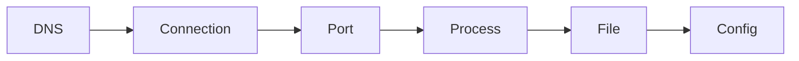

:::tip[First time here?]
If it is not yet clear what DevOps is or which part of the cycle this Atlas covers, start with [What DevOps is](/en/what-is-devops/) and come back.
:::

## The first skill: observe

DevOps does not start with a tool. It starts with the ability to ask concrete questions about a system: which process is listening, which file changed, why a request does not arrive, and what evidence supports a decision.

This module builds the minimum map for moving through Linux and a network. You do not need to memorize hundreds of commands; you need to connect small, verifiable observations.

## Walk the system from the outside in

When something fails, always follow the same order. Each stop rules out part of the problem before you touch the next:

## The foundations map

| Signal | Useful question | Page |
| --- | --- | --- |
| System | Where does configuration live, and who may touch it? | [Linux](./linux/) |
| Process | What is running and who started it? | [The terminal](./terminal/#observing-processes) |
| Network | Is the application listening and reachable? | [Essential networking](./networking/) |
| Practice | Can I reproduce an investigation? | [Practice · shell and network](./lab-shell-and-network/) |

:::tip[Change the order of your questions]
Walking the system from the outside in —DNS → connection → port → process → file → configuration— reduces the temptation to change five things at once.
:::

## Expected outcome

You will be able to describe a request path, find a process and verify a connection using local tools. That vocabulary becomes the foundation for Git, Docker and CI/CD.
