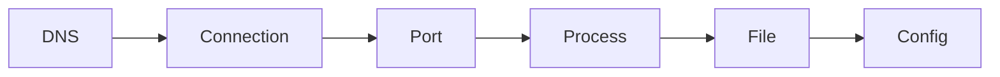

:::tip[First time here?]
If it is not yet clear what DevOps is or which part of the cycle this Atlas covers, start with [What DevOps is](/en/what-is-devops/) and come back.
:::

**Where you are:** the starting point. Everything that follows — Git, Docker, CI, deployments — assumes you can look at a machine and say what is happening on it.

## The first skill: observe

DevOps does not start with a tool. It starts with the ability to ask concrete questions about a system: which process is listening, which file changed, why a request does not arrive, and what evidence supports a decision.

This module builds the minimum map for moving through Linux and a network. You do not need to memorise hundreds of commands; you need to connect small, verifiable observations.

## Walk the system from the outside in

When something fails, always follow the same order. Each stop rules out part of the problem before you touch the next:

## The foundations map

| Signal | Useful question | Page |
| --- | --- | --- |
| System | Where does configuration live, and who may touch it? | [Linux](/en/foundations/linux/) |
| Process | What is running and who started it? | [The terminal](/en/foundations/terminal/#observing-processes) |
| Network | Is the application listening and reachable? | [Essential networking](/en/foundations/networking/) |
| Practice | Can I reproduce an investigation? | [Practice · shell and network](/en/foundations/lab-shell-and-network/) |

:::tip[Change the order of your questions]
Walking the system from the outside in —DNS → connection → port → process → file → configuration— reduces the temptation to change five things at once.
:::

## What you can do with this

These pages let you describe a request path, find a process and verify a connection using local tools. That vocabulary is the foundation for Git, Docker and CI/CD.

## Where this breaks

| Symptom | What causes it | Where it continues |
| --- | --- | --- |
| Two people change the same file and one overwrites the other's work | There is no history, and no way to propose a change before applying it | [Collaboration](/en/collaboration/) |
| The application starts on your machine and not on another | Each machine has something different installed and nobody pinned the list | [Containers](/en/containers/) |
| You find out something does not build once it is already on the server | The first check happens too late, and in the worst place | [Continuous integration](/en/integration/) |
