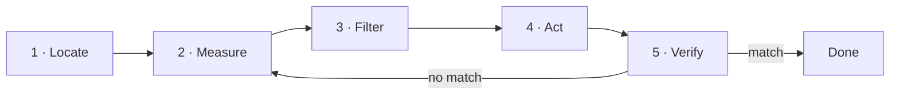

## The terminal is not magic

A shell is an interpreter: it reads text, runs programs and connects their input and output. Its value is not that it looks cryptic; it is that each step can become a repeatable instruction —something you can save, review and automate later.

Every program starts with three channels: **input** (`stdin`), **output** (`stdout`) and **errors** (`stderr`). Keeping them apart lets you save a result without mixing it with the warnings.

```bash
pwd                             # where am I?
ls -la                          # what is here, hidden files included?
printf 'hello\n' > greeting.txt # redirect stdout to a file
```

Output is an interface too. Before running a destructive command, check where you are, which files it selects and which permissions your user has.

## Reading files and permissions

`ls -l` is not decoration: each column answers an operational question.

```bash
ls -l server.log
# -rw-r--r-- 1 deploy web 2048 jul 22 09:14 server.log
```

Left to right: type and **permissions** (`rw-` for the owner, `r--` for the group, `r--` for everyone else), link count, **owner**, **group**, size in bytes, date and name. When a service "cannot write its log", the answer is almost always in those three triplets.

```bash
chmod 640 server.log         # owner reads/writes, group reads, others nothing
chown deploy:web server.log  # change owner and group
```

Change permissions with intent, not by reflex: `640` says something precise about who can do what.

## Composition with pipes

The `|` character connects one process's output to the next process's input. A useful investigation is often a small, readable composition:

```bash
ps aux | grep '[n]ginx'        # is nginx running? with which PID?
find . -name '*.log' | wc -l   # how many logs under this tree?
```

The `[n]ginx` pattern keeps `grep` out of its own result: the brackets form a class matching the letter `n`, but the literal text `[n]ginx` is no longer on that line. It is not a trick to copy; it expresses exactly what you are looking for.

## Processes and services

A process is a live instance of a program: it has a PID, a user, a state and usually open files or sockets.

```bash
ps -ef            # every process on the system
ss -lntup         # what is listening, on which port, and who owns it?
```

`ss` answers a very concrete question: is something listening on the port I expect? On modern Linux, many programs run as **services** managed by `systemd`:

```bash
systemctl status nginx       # is it active? since when?
journalctl -u nginx -n 50    # its last 50 log lines
```

:::caution Do not reach for elevated permissions by reflex
`sudo` increases the blast radius of a command. Read first; elevate only when the system asks you to and you understand what will change.
:::

## Mental model: the diagnostic loop

Think of the terminal as a diagnostic camera. Every intervention follows the same loop, and you only act **after** you measure:



1. **Locate** the context (`pwd`, `whoami`, `env`).
2. **Measure** the state (`ps`, `free`, `df`, `ss`).
3. **Filter** the evidence (`grep`, `awk`, `sort`).
4. **Act** with the smallest useful change.
5. **Verify** that the final state matches your intent; if not, measure again.

## Check your understanding

<details>
<summary>Why use the [n]ginx pattern instead of nginx?</summary>

Because `grep 'nginx'` would also find its own process in the `ps` output. The brackets `[n]` form a character class that matches the letter `n`, but the literal text `[n]ginx` no longer appears on the `grep` line itself, so it excludes itself from the result.

</details>

<details>
<summary>A service cannot write to /var/log/app.log. What do you check first?</summary>

`ls -l /var/log/app.log`, to read the owner and permissions. If the process runs as the `app` user but the file belongs to `root` with no group write permission, that is the cause —and it is fixed with `chown`/`chmod`, without touching the code.

</details>

## Keep exploring

- `man` is your first stop: try `man ss` or `man chmod`. The examples section is often enough.
- [Linux Journey](https://linuxjourney.com/) — a free, guided tour of the command line.
- [ExplainShell](https://explainshell.com/) — paste a command and it explains each part.
