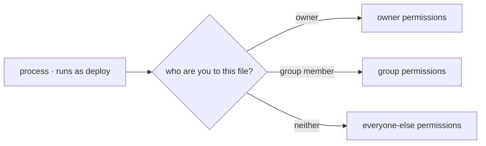

## Why Linux and not another system

You can develop on Windows or macOS just fine. But when that code actually runs, it almost always lands on Linux:

- **Servers.** The vast majority of web servers, and of the virtual machines you rent from a cloud, boot a Linux image.
- **Containers.** A Docker image is, on the inside, a Linux filesystem. When you run `docker run` on your Mac, there is a Linux virtual machine underneath.
- **Automation.** The runners your CI executes on are Linux by default.

It is not only market share. Linux was designed to be administered **without a screen**: a multi-user system operated through text, at a distance, over an SSH connection. That has a direct consequence for your daily work: if the state of the system is configured with text files and changed with commands, then it can be versioned, reviewed, and automated. A system you can only administer by clicking gives you none of that.

:::note[Unix is not Linux]
macOS is also a Unix and shares many commands, but it is not Linux: no `systemd`, no `ss`, and several flags differ because its tools come from the BSD family. It is fine for practising the basics, not for assuming that what works there will work on the server.
:::

## What a distribution is

Linux, strictly speaking, is only the **kernel**: the piece that talks to the hardware and hands out CPU, memory, and disk among processes. A **distribution** is that kernel packaged with everything else — base programs, a package manager, a version and update policy — to make a usable system.

What changes between distributions is mostly how software gets installed and updated. The model of the system — processes, permissions, files — is the same.

| Family | Package manager | Where you will meet it |
| --- | --- | --- |
| Debian · Ubuntu | `apt` | The default choice on most servers and tutorials |
| RHEL · Fedora · Rocky | `dnf` | Corporate environments with long-term support |
| Alpine | `apk` | Container images, thanks to its minimal size |

```bash
apt update                  # refresh the list of available packages
apt install -y nginx        # install from the distribution's repository
apt list --installed | head # what is installed, and at which version
```

Installing from the repository, rather than downloading a loose binary off the internet, is what makes a machine rebuildable tomorrow. That idea comes back later, dressed up as container images.

## Getting a Linux to practise on

You do not need to dedicate a machine. From simplest to closest to production:

- **A container**, if you already have Docker: `docker run -it --rm debian bash` drops you inside a Debian in seconds.
- **WSL 2**, if you are on Windows: install Ubuntu with `wsl --install` and you get a real Linux integrated into the system.
- **A virtual machine** (UTM, VirtualBox, Multipass): heavier, but it behaves like a full server, with boot and services.
- **A VPS**: a real machine rented for little money, which you enter over SSH. It is the closest thing to operating for real.

Any of the four is enough for everything in this module.

## The file tree

Linux has no `C:` or `D:` drives. There is **a single root**, `/`, and everything hangs off it, including disks you attach later. When you investigate a problem, this table tells you where to look:

| Path | What it holds | Why it matters to you |
| --- | --- | --- |
| `/etc` | System and service configuration | The file you probably need to change lives here |
| `/var/log` | Logs | The first evidence when something fails |
| `/var/lib` | Data services need to keep | What you cannot afford to lose on a reinstall |
| `/home/user` | Each user's personal files | Your space, no special permissions needed |
| `/usr/bin` | Installed programs | Where what you install with the package manager ends up |
| `/tmp` | Temporary files | May be cleaned automatically; never keep anything that matters there |
| `/proc`, `/sys` | The kernel's view, generated on the fly | Files that do not exist on disk: they are the system's state |

That already gives you a hypothesis for almost any failure: configuration is in `/etc`, what happened is in `/var/log`, and what the service stored is in `/var/lib`.

## Users, groups, and permissions

Here is the model that explains most of the "permission denied" you are going to meet.

**Every process runs as a user.** Not just you: services get their own user too, unprivileged and unable to log in, so that a flaw in the application does not compromise the whole machine. A **group** lets several users share access to the same things.

Every file carries three facts: an owner, a group, and what each party may do.



The system answers that question in that order and applies **only** the first case that matches. Being in the group does not add the owner's permissions on top.

```bash
ls -l server.log
# -rw-r--r-- 1 deploy web 2048 Jul 22 09:14 server.log
```

Left to right: type and **permissions**, link count, **owner** (`deploy`), **group** (`web`), size, date, and name. Permissions are read as three `rwx` triplets — read, write, execute — for owner, group, and everyone else: here `rw-` for `deploy`, `r--` for the `web` group, `r--` for all the rest.

Each triplet is also written as a number: `r=4`, `w=2`, `x=1`, added up.

```bash
chmod 640 server.log         # owner reads/writes (6), group reads (4), others nothing (0)
chown deploy:web server.log  # change owner and group
```

When a service "cannot write its log", the answer is almost always in those three triplets: the process runs as a user who is neither the owner nor in the group.

**`root` is the user with very broad privileges over the system**, and `sudo` runs a single command as them.

:::caution[Do not reach for elevated permissions by reflex]
`sudo` widens the blast radius of a command: a mistake stops affecting your files and starts affecting the machine. Read first; elevate only when the system asks you to and you understand what will change.
:::

## Services: what the system starts for you

An application in production is not launched by hand and left open in a terminal. It is registered as a **service**, and the system can take care of starting it at boot, restarting it when its configuration says to, and collecting its output into a central log. On modern Linux, the piece that does this is `systemd`.

```bash
systemctl status nginx    # is it active? since when? did it restart itself?
systemctl restart nginx   # restart it
systemctl enable nginx    # and have it start on the next boot too
journalctl -u nginx -n 50 # its last 50 log lines
```

`systemctl status` answers in one shot three questions you would otherwise chase separately: whether the process is alive, since when, and what it said before dying.

Hold on to that idea, because it comes back: a container solves the same problem with different parts — it also defines which process starts, what happens if it dies, and where its logs go.

## Keep exploring

- [Linux Journey](https://linuxjourney.com/) — a free, guided tour of the system, from zero.
- [Filesystem Hierarchy Standard](https://refspecs.linuxfoundation.org/FHS_3.0/fhs/index.html) — what is supposed to live in each directory.
- `man hier` — the same hierarchy, explained inside your own machine.
