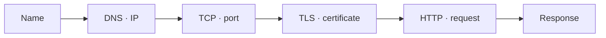

## A request is a route

When you visit `https://example.com/api`, several things happen in order. The client resolves a name, opens a connection, negotiates TLS and only then sends an HTTP request. Each leg is a **diagnostic boundary**: once you know which one you are on, you know what evidence to request.



A failure lives on one of those boundaries, not all at once. The rule is to walk them from the outside in.

## DNS translates, it does not transport

DNS turns a name into records: an IP in an `A` record (or `AAAA` for IPv6), an alias in a `CNAME`. It does not carry your request; it only tells you where to go.

```bash
dig +short example.com        # which IP answers this name?
cat /etc/hosts                # is there a local override?
```

If the name does not resolve, debugging the application is premature: you do not yet know which machine you are talking to.

## Connection: ports, sockets and TLS

A port identifies a process entry point within a machine. Seeing an open port does not prove the application works, but not seeing it rules out part of the path.

```bash
ss -lnt                                  # what is listening locally?
curl -v https://example.com 2>&1 | head  # narrates resolution, TCP and TLS
```

`curl -v` tells the story step by step: it resolves the IP, opens TCP to port 443, presents the TLS **certificate** and only then sends the HTTP request. `127.0.0.1` accepts local traffic only; `0.0.0.0` may accept traffic from several interfaces and deserves more care. TLS exists for two reasons: to encrypt the connection and to prove the server is who it claims to be.

:::note[One layer at a time]
When a URL fails, check resolution (DNS) first, then connection (TCP/TLS), and finally the application (HTTP). A timeout and a `404` are different problems.
:::

## The HTTP contract

An HTTP response communicates far more than a body. The **status code** summarizes what happened:

| Family | Meaning | Example |
| --- | --- | --- |
| `2xx` | Success | `200 OK` |
| `3xx` | Redirection | `301 Moved Permanently` |
| `4xx` | Client error | `404 Not Found` |
| `5xx` | Server error | `503 Service Unavailable` |

A `4xx` says "your request is wrong"; a `5xx` says "the server failed". Confusing them sends the investigation to the wrong side.

```bash
curl -s -o /dev/null -w '%{http_code}\n' https://example.com
```

Headers complete the contract: content type, caching and policies. The DevOps habit is to make this contract visible in logs, tests and documentation.

## Check your understanding

<details>
<summary>curl returns "Could not resolve host". Which boundary are you on?</summary>

DNS: the name was not translated into an IP, so there was no connection and no HTTP. Check `dig +short`, your resolver and `/etc/hosts` before looking at the application.

</details>

<details>
<summary>You get 503 instead of 200. Is it a client or a server problem?</summary>

Server: the `5xx` family means it could not complete a valid request —often overload or a downstream dependency being down. A `4xx` would be the client. Look at the service logs and status, not your request.

</details>

## Keep exploring

- [MDN · HTTP](https://developer.mozilla.org/en-US/docs/Web/HTTP) — a clear reference for methods, statuses and headers.
- [High Performance Browser Networking](https://hpbn.co/) — how a request really travels (free online).
- `man curl` and `man dig` — the flags you will use daily.
