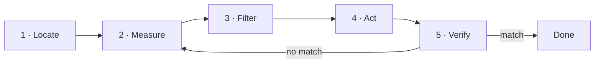

## The terminal is not magic

A shell is an interpreter: it reads text, runs programs, and connects their inputs and outputs. Its value is not that it looks cryptic; it is that each step can become a repeatable instruction — something you can save, review, share, and automate later. You cannot paste a click into a ticket; you can paste a command.

Every program starts with three channels: **input** (`stdin`), **output** (`stdout`), and **errors** (`stderr`). Keeping them apart lets you save a result without mixing it with the warnings.

```bash
pwd                             # where am I?
ls -la                          # what is here, hidden files included?
printf 'hello\n' > greeting.txt # redirect stdout to a file
command 2> errors.txt           # redirect stderr only
```

Output is an interface too. Before running a destructive command, check where you are, which files it selects, and which user you are doing it as. If you need to review how owner and permissions are read, they are in [Linux](/en/foundations/linux/#users-groups-and-permissions).

## Composition with pipes

The `|` character connects one process's output to the next process's input. That is the central idea of the command line: instead of one enormous program that does everything, you chain small pieces that each do one thing.

```bash
ps aux | grep '[n]ginx'        # is nginx running? with which PID?
find . -name '*.log' | wc -l   # how many logs under this tree?
journalctl -u nginx | tail -20 # the last 20 lines of its log
```

The `[n]ginx` pattern keeps `grep` out of its own result: the brackets form a class matching the letter `n`, but the literal text `[n]ginx` is no longer on that line. It is not a trick to copy; it expresses exactly what you are looking for.

## Observing processes

A process is a live instance of a program: it has a PID, a user, a state, and usually open files or sockets.

```bash
ps -ef            # every process on the system
ss -lntup         # what is listening, on which port, and who owns it?
```

Those two commands answer different questions. `ps` says what is running; `ss` says which ports are listening locally. A process can be alive and listening on no port at all, so the problem is not necessarily that "the application is down".

When the process you are investigating is managed by the system, `systemctl status` and `journalctl` give you the same thing with more context — that is in [Linux · services](/en/foundations/linux/#services-what-the-system-starts-for-you).

## Mental model: the diagnostic loop

Think of the terminal as a diagnostic camera. Every intervention follows the same loop, and you only act **after** you measure:



1. **Locate** the context (`pwd`, `whoami`, `env`).
2. **Measure** the state (`ps`, `free`, `df`, `ss`).
3. **Filter** the evidence (`grep`, `awk`, `sort`).
4. **Act** with the smallest useful change.
5. **Verify** that the final state matches your intent; if not, measure again.

The step most often skipped is the second, and it is the one that separates fixing from guessing: without a measurement beforehand you cannot show your change did anything.

## Check your understanding

<details>
<summary>Why use the [n]ginx pattern instead of nginx?</summary>

Because `grep 'nginx'` would also find its own process in the `ps` output. The brackets `[n]` form a character class that matches the letter `n`, but the literal text `[n]ginx` no longer appears on the `grep` line itself, so it excludes itself from the result.

</details>

<details>
<summary>You save a command's output with `> output.txt` and the file comes out empty, though you saw text on screen. What happened?</summary>

What you saw was `stderr`, and `>` only redirects `stdout`. The two channels exist precisely so you can separate them: use `2> errors.txt` to capture errors on their own, or `> all.txt 2>&1` if you want both in the same file.

</details>

## Keep exploring

- `man` is your first stop: try `man ss` or `man find`. The examples section is often enough.
- [ExplainShell](https://explainshell.com/) — paste a command and it explains each part.
- [tldr pages](https://tldr.sh/) — the useful examples for each command, without reading the whole manual.
