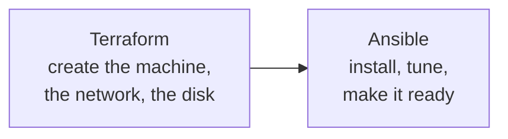

**Where you are:** you already know how to set up a server, package the application, check it automatically, deploy it, and decide when more than one machine is needed. You did all of that by hand at least once. Here that manual work turns into files.

## The last thing still living in somebody's memory

Look over what is already written in your repository: the code, the tests, the `Dockerfile`, the CI workflow, the Compose file. Now look over what is not: which instance type you requested, which ports you opened in the provider's panel, which packages you installed, which line you changed in `sshd_config`.

That second list is the only part of the system still depending on somebody remembering. And it is the part you need when the machine disappears.

## Two jobs, two tools

The distinction is not a matter of taste: they are different problems. Creating a server goes through the provider's API and requires remembering what was created so as not to duplicate it. Configuring the inside goes over SSH and can be checked every time, remembering nothing.

That is why Terraform keeps a state file and Ansible does not need one.

## The route

| Moment | Question | Page |
| --- | --- | --- |
| Reason | What breaks when the infrastructure exists only on one machine? | [Why write infrastructure down](/en/infrastructure/why-iac/) |
| Create | How do I declare the resources, and what is that state file? | [Terraform and state](/en/infrastructure/terraform/) |
| Configure | How do I leave a machine as it should be, a thousand times over? | [Ansible and idempotence](/en/infrastructure/ansible/) |

:::note[Writing infrastructure down has a cost too]
It adds a language, a tool, and — in Terraform's case — a state that has to be stored, encrypted and locked. With one machine and one environment you would rebuild in an afternoon, that cost is not recovered. It starts paying off with two environments that have to match, or two people with access.
:::

## What you can do with this

These pages let you declare an environment's resources and create them without touching a web panel, leave a machine's configuration described in a file that applies without fear of repeating it, and understand why two servers that started identical stopped being so.
