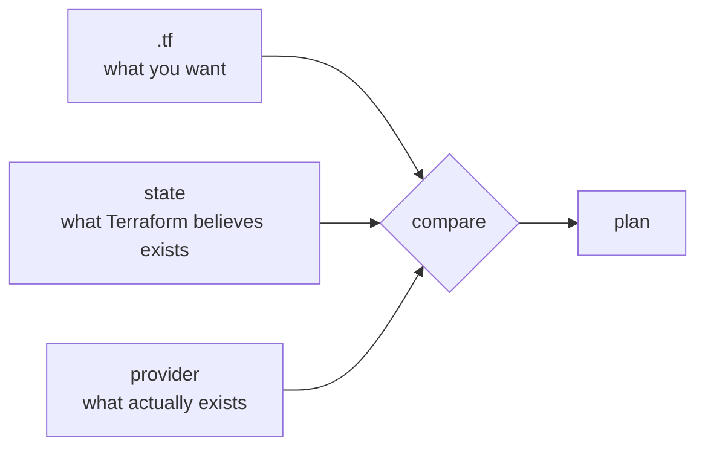

## Describing instead of requesting

Terraform reads `.tf` files declaring which resources should exist, asks the provider what is actually there, and works out the actions to make them match.

```hcl
terraform {
  required_providers {
    hcloud = { source = "hetznercloud/hcloud", version = "~> 1.50" }
  }
}

resource "hcloud_server" "app" {
  name        = "atlas-app"
  image       = "ubuntu-24.04"
  server_type = "cx22"
  location    = "nbg1"
  ssh_keys    = [hcloud_ssh_key.deploy.id]
}

resource "hcloud_firewall" "web" {
  name = "atlas-web"

  rule {
    direction  = "in"
    protocol   = "tcp"
    port       = "443"
    source_ips = ["0.0.0.0/0", "::/0"]
  }
}
```

The reference `hcloud_ssh_key.deploy.id` does two things at once: it uses the value and declares a dependency. Terraform derives the creation order from that; you never write the order anywhere.

## The cycle

```bash
terraform init          # download the declared providers
terraform plan          # what it would do, without doing it
terraform apply         # does it, after confirmation
terraform destroy       # removes everything it manages
```

`plan` is the part not to skip, and not out of generic caution. Its output distinguishes three symbols, and the third is the one that matters:

```
  + create        a new resource
  ~ update        modified in place
-/+ destroy and then create   removed and rebuilt
```

That `-/+` appears when you change an attribute the provider cannot modify on the fly — a server's image type, sometimes its location. On a database it means losing the data. The plan is the only moment that is visible before it happens.

## State

Terraform needs to know that the `atlas-app` server in your file is *that* specific server at the provider, and not a new one. That mapping lives in the **state file**, a JSON written on every `apply`.



Without state, Terraform cannot tell "this resource already exists and changed" from "this resource does not exist": it would create everything again.

Three practical consequences:

- **State holds secrets in clear text.** Generated passwords, keys, connection strings: whatever the provider returns ends up written there. It does not go in the repository.
- **Shared, and locked.** If two people apply against the same state at once, it corrupts. Remote backends — S3 with DynamoDB, Terraform Cloud, GCS — hold the file and take a lock while somebody applies.
- **It can fall out of sync.** If somebody deletes the server from the web panel, state still believes it exists. The next `plan` notices and offers to recreate it.

```hcl
terraform {
  backend "s3" {
    bucket         = "atlas-tfstate"
    key            = "prod/terraform.tfstate"
    region         = "eu-central-1"
    dynamodb_table = "atlas-tflock"
    encrypt        = true
  }
}
```

:::caution[State is as sensitive as your credentials]
A leaked state file hands over the complete inventory of your infrastructure and the secrets the provider returned when creating it. Encrypt it at rest, restrict who can read it, and never push it to the repository — a `.gitignore` with `*.tfstate` is the first thing written.
:::

## Modules and environments

When staging and production have to match, whatever repeats becomes a **module**: a parameterised set of resources instantiated with different values.

```hcl
module "staging" {
  source      = "./modules/environment"
  environment = "staging"
  server_type = "cx22"
}

module "production" {
  source      = "./modules/environment"
  environment = "production"
  server_type = "cx42"
}
```

Both environments share a definition and differ only in what is declared. Drift stops being possible by construction: there are no two descriptions that can grow apart.

Each environment needs its own state. Mixing them into one means an `apply` intended for staging has production's resources in front of it.

## Check your understanding

<details>
<summary>Why does Terraform need a state file if it can ask the provider what exists?</summary>

Because the provider knows which resources exist, but not which of them corresponds to which block in your file. State holds that mapping. Without it, Terraform cannot tell a resource it already manages and that changed from one that does not exist yet, and it would create duplicates.

</details>

<details>
<summary>The plan shows -/+ on your database. What does it mean and what do you do?</summary>

The attribute you changed cannot be modified in place, so Terraform will delete the resource and create a new one — losing the data. You stop there: either revert that change, or do the migration by hand with a backup in front of it. That symbol is the reason for running `plan` before `apply`.

</details>

<details>
<summary>Two people run apply against the same state at once. What can happen?</summary>

The state ends up corrupt or incomplete: both read the same version and both write over it, so the result reflects what neither of them did. That is why remote backends take a lock while somebody applies; the second one waits instead of overwriting.

</details>

## Keep exploring

- [Terraform · language](https://developer.hashicorp.com/terraform/language) — the reference for resources, variables and modules.
- [Terraform · remote state](https://developer.hashicorp.com/terraform/language/state/remote) — backends, locking and encryption.
- [OpenTofu](https://opentofu.org/) — the open-source fork, compatible with the same syntax.
