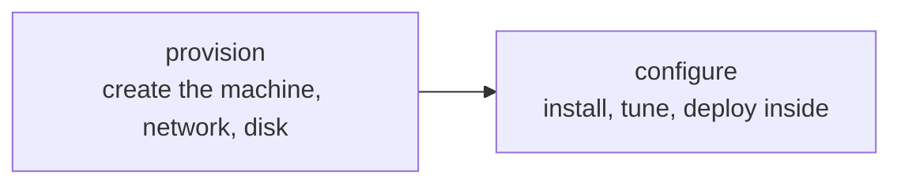

## The server nobody knows how to rebuild

When you configured your VPS by hand, every decision ended up in one place: the machine. The user you created, the package you installed to work around a bug, the line you changed in `sshd_config` at two in the morning. None of it is written anywhere.

That works until you need a second identical machine. Then you discover that "identical" cannot be reproduced, because the complete list of what you did does not exist: what exists is a machine that works and nobody knows exactly why.

This is called a **pet server**: unique, irreplaceable, with a name of its own and a history known only to whoever was there. The opposite is treating them as **cattle**: interchangeable machines, destroyed and recreated because their definition lives elsewhere.

:::caution[A data backup does not back up the configuration]
Dumping the database protects the data. It does not protect the dozens of system decisions that make the application start. If the disk disappears, you have the data and nowhere to put it.
:::

## Configuration drift

Even if you build two servers on the same day with the same steps, in six months they will not be alike. This is **configuration drift**, and it does not come from carelessness:

- A midnight incident gets fixed on the affected machine, and only that one.
- A security update lands when it lands, which is not the same day on both.
- Somebody tries something on staging and leaves it in place.
- A package's default version changes between two installs weeks apart.

The result is a failure that is expensive to diagnose: it works in one environment and not the other, and the difference is undocumented because nobody knows what it is.

## What changes by writing it down

If infrastructure lives in versioned files, it inherits everything you already have set up for code:

| It becomes | Because |
| --- | --- |
| Reviewable | An infrastructure change goes through a pull request |
| Versioned | `git log` says who opened that port, and when |
| Reproducible | Creating the second environment is running the same thing |
| Reversible | Going back is going back to the previous commit |
| Documented | The file is the documentation, and it cannot go stale |

That last row carries the most weight. A document about how a server is configured goes out of date with the first change made by hand. A file that **is** the configuration does not go out of date that way: if it changes, the machine changes.

## Two different jobs

They use different tools because they solve different things:

- **Provisioning** is creating the resources you used to request through a web panel: the instance, the IP, the DNS record, the volume, the provider's firewall rules. This is **Terraform**'s territory.
- **Configuring** is what happens inside a machine that already exists: installing packages, writing files, starting services. This is **Ansible**'s territory.

They can be used together — Terraform creates the machine, Ansible makes it ready — and also separately. If your servers already exist and you only want to stop configuring them by hand, Ansible alone is a complete answer.

## Declarative, and what that implies

Both tools work the same way: you describe **the result** and they work out the steps. That has a practical consequence worth understanding before writing anything.

A script running `adduser marta` fails the second time, because the user already exists. A description saying "the user marta exists" can run a thousand times with the same result. That property is called **idempotence**, and it is what lets you reapply the same definition without fear — which is exactly what you do every time you change one line.

## When it does not pay off yet

It is not free. Writing infrastructure down adds a language, a tool, a state to maintain and a new way to break things. Signals that it is not time:

- One machine, one environment, that you would rebuild in an afternoon.
- The project still changes shape every week.
- Nobody but you is ever going to touch it.

And signals that it is: more than one environment that has to match, more than one person with access, or the question "what happens if this machine disappears?" without a comfortable answer.

An honest middle ground: a provisioning script in Bash, versioned, not idempotent but at least **existing**. It is far below Terraform and far above somebody's memory.

## Keep exploring

- [Martin Fowler · SnowflakeServer](https://martinfowler.com/bliki/SnowflakeServer.html) — the irreproducible server, and why it appears.
- [The Twelve-Factor App · dev/prod parity](https://12factor.net/dev-prod-parity) — keeping development and production alike.
