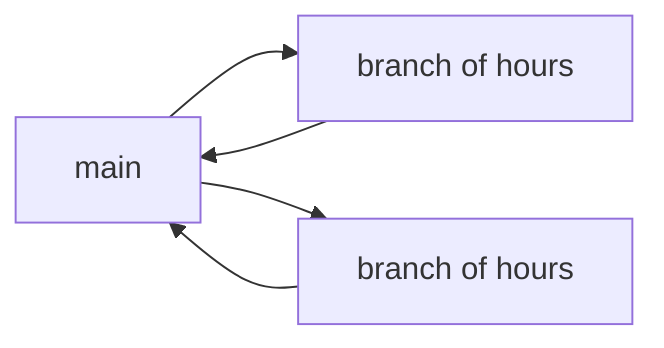
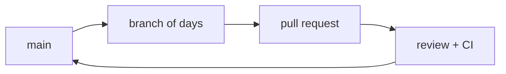
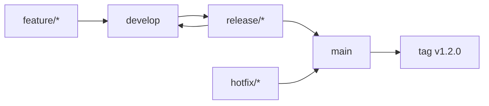

## A branching model is a consequence, not a preference

It is tempting to read the names — trunk-based, GitHub Flow, GitFlow — as styles you pick by taste. They are not. Each one answers one concrete question about how you deliver:

> How long can a change exist without being integrated with everyone else's work?

Everything else — how many branches there are, what they are called, who may write to which — follows from that answer. That is why this topic does not sit next to the Git commands: it cannot be answered before you know what a deployment costs.

## Three questions that decide for you

| Question | If the answer is… | Then |
| --- | --- | --- |
| How many published versions do you support at once? | One | You do not need release branches |
| | Several, each getting its own patches | You need release branches |
| How many environments sit between `main` and production? | None or one | The artifact can come straight from `main` |
| | Several, with human approval | You need a named cut-off point |
| How long does your CI take to return a verdict? | Minutes | You can integrate several times a day |
| | Hours | You will accumulate unintegrated work |

If all three answers land in the first row, any complex model will only cost you money.

## The three models

### Trunk-based

Everyone integrates into `main` at least once a day. Branches last hours, not days. Whatever is unfinished ships anyway, switched off behind a *feature flag*: a condition in the code that decides at runtime whether that feature is active, so the code can travel to production without the feature being available.

It demands fast CI and a suite you trust, because there is almost no window between writing and publishing. In exchange, merge conflicts nearly disappear: nobody drifts far enough from the trunk to collide.

### GitHub Flow

One branch per intention, one pull request per branch, `main` always deployable. It is trunk-based with an explicit review stop and slightly longer branches.

It is the reasonable starting point for almost any project: it keeps one single line of truth and still lets another person read the change before it lands. The claim "`main` is always deployable" is what holds it up, and it is only true if CI genuinely checks it.

### GitFlow

Two permanent branches (`main` and `develop`) plus three temporary families (`feature/*`, `release/*`, `hotfix/*`). `main` only ever receives published, tagged versions; day-to-day work lives on `develop`.

It solves a real problem: supporting several published versions at once and being able to patch an old one without dragging along whatever is in development. That is the case for software installed at a customer's site, not for a web application with a single live deployment.

## What each one costs

| Model | When it earns its cost | What it charges you |
| --- | --- | --- |
| Trunk-based | One live deployment, CI in minutes, a trusted suite | You need feature flags and daily discipline |
| GitHub Flow | One live deployment, review by pull request | Branches of days: some conflicts and review queues |
| GitFlow | Several published versions supported simultaneously | Two permanent branches that drift apart, and large merges |

## Why a long branch is paid back with interest

A branch that has not touched `main` for three weeks is not "in progress": it is a deferred integration. Meanwhile `main` moved on, and the conflict you will resolve at the end is the sum of every conflict you would have resolved one at a time.

The cost does not grow linearly. It grows with the number of other people's changes that happened while you were not looking, and any of them can interact with yours.

:::caution[GitFlow by default is the most expensive mistake]
Adopting `develop`, `release/*` and `hotfix/*` on a project with a single live deployment adds two merges per change and a branch that drifts, in exchange for a capability — patching an old version — you are never going to use. If you do not have customers on different versions, you do not need GitFlow.
:::

## Check your understanding

Why does trunk-based require feature flags?

Because if you integrate into `main` several times a day, half-finished code will reach production. The flag separates two things that normally travel together: deploying the code and enabling the feature. The code ships; the condition decides whether anyone sees it.

Your team maintains a single web application with one production deployment. What does GitFlow's develop branch give you?

Nothing `main` does not already give you. `develop` exists to separate "what is in development" from "what is published", and that distinction only matters when there are published versions still receiving patches. With a single live deployment, `main` already is exactly that, and the second branch only adds a merge and an opportunity for the two to drift apart.

Your CI takes fifty minutes. Which branching model becomes hard, and why?

Trunk-based. Its premise is integrating several times a day, and that needs a verdict in minutes. At fifty minutes per attempt, people batch work up to avoid waiting, branches lengthen on their own, and you end up in the model you did not choose. Before changing the branching model, shorten CI.

## Keep exploring

- [Trunk Based Development](https://trunkbaseddevelopment.com/) — the model explained by the people who advocate it.
- [GitHub Flow (official guide)](https://docs.github.com/en/get-started/using-github/github-flow) — the flow in its canonical form.
- [A successful Git branching model](https://nvie.com/posts/a-successful-git-branching-model/) — the original GitFlow article, with the author's note on when not to use it.
