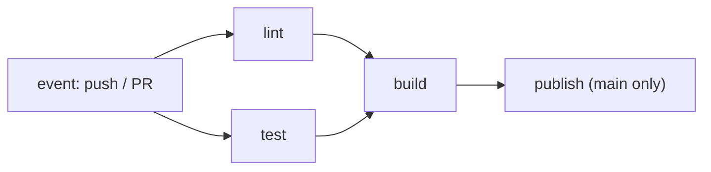

## A workflow is an executable promise

GitHub Actions describes what happens in response to repository events (`push`, `pull_request`, tags). A workflow is made of **jobs** —which run on separate machines and in parallel— and each job of **steps** in order.

That machine is called a **runner**. `runs-on: ubuntu-latest` asks for a freshly created Linux virtual machine, destroyed once the job ends: nothing survives from one run to the next, which is why every workflow has to install what it needs.



## Validate with lint, tests and build

A good pipeline does not only compile: it checks formatting, types and behaviour before packaging.

**Lint** is the cheapest check of all: a program reads the code without running it and flags whatever breaks a convention or smells like a bug — an unused variable, a missing `await`, an import that no longer exists. It takes seconds, so its verdict arrives first.

```yaml
name: Validate Atlas
on:
  pull_request:
  push:
    branches: [main]

jobs:
  lint:
    runs-on: ubuntu-latest
    steps:
      - uses: actions/checkout@v4
      - uses: pnpm/action-setup@v4
        with: { version: 10.29.3 }
      - uses: actions/setup-node@v4
        with: { node-version: 22, cache: pnpm }
      - run: pnpm install --frozen-lockfile
      - run: pnpm run lint        # formatting and conventions

  test:
    runs-on: ubuntu-latest
    steps:
      - uses: actions/checkout@v4
      - uses: pnpm/action-setup@v4
        with: { version: 10.29.3 }
      - uses: actions/setup-node@v4
        with:
          node-version: 22
          cache: pnpm
      - run: pnpm install --frozen-lockfile
      - run: pnpm run check       # types
      - run: pnpm run test:e2e    # behaviour

  build:
    needs: [lint, test]           # waits for lint and test to pass
    runs-on: ubuntu-latest
    steps:
      - uses: actions/checkout@v4
      - uses: pnpm/action-setup@v4
        with: { version: 10.29.3 }
      - uses: actions/setup-node@v4
        with: { node-version: 22, cache: pnpm }
      - run: pnpm install --frozen-lockfile
      - run: pnpm run build
```

`cache: pnpm` reuses dependencies across runs; `lint` and `test` run in parallel and `needs: [lint, test]` makes `build` wait for both. Every step should say what it guarantees and which evidence it leaves.

## Validation is not deployment

Pull requests run checks without touching production. Only after merging into `main` should the publishable image be built and deployed, usually in a separate job protected by an **environment**:

```yaml
  deploy:
    needs: build
    if: github.ref == 'refs/heads/main'
    environment: production
    runs-on: ubuntu-latest
    steps:
      - run: echo "publish image and deploy"
```

The `if` limits the deploy to `main`; the `environment` lets you require approvals or store per-environment secrets.

:::tip[Treat the pipeline as a product]
A CI error is a user experience. Short messages, reproducible commands and visible artifacts reduce the time between failure and learning.
:::

## Secrets and permissions

A **secret** is a value that grants access to something: a token, an API key, the password the pipeline uses to reach the server. They live stored in GitHub, never in the YAML or the repository — anyone who clones the code would carry them away — and the workflow receives them as variables that the run log masks.

**Permissions** are the other half: give each job the minimum it needs: read code to validate and write packages only in the job that publishes.

```yaml
permissions:
  contents: read
  packages: write
```

Where exactly they live, why permission matters more than the hiding place, and what to do when one escapes: [Secrets and permissions](/en/integration/secrets/).

## Check your understanding

<details>
<summary>You want build to run only if test passes. What do you use?</summary>

`needs: test` on the build job. By default jobs run in parallel; `needs` declares a dependency and makes build wait for test to finish successfully.

</details>

<details>
<summary>Your deploy runs on every pull request. How do you limit it to main?</summary>

With a condition on the job, `if: github.ref == 'refs/heads/main'`, ideally combined with an `environment` that requires approval. Validation runs on every PR; deployment only after integration.

</details>

## Keep exploring

- [GitHub Actions (docs)](https://docs.github.com/en/actions) — events, jobs, contexts and expressions.
- [Workflow syntax](https://docs.github.com/en/actions/using-workflows/workflow-syntax-for-github-actions) — every field of the YAML.
- [Environments](https://docs.github.com/en/actions/deployment/targeting-different-environments/using-environments-for-deployment) — per-environment approvals and secrets.
